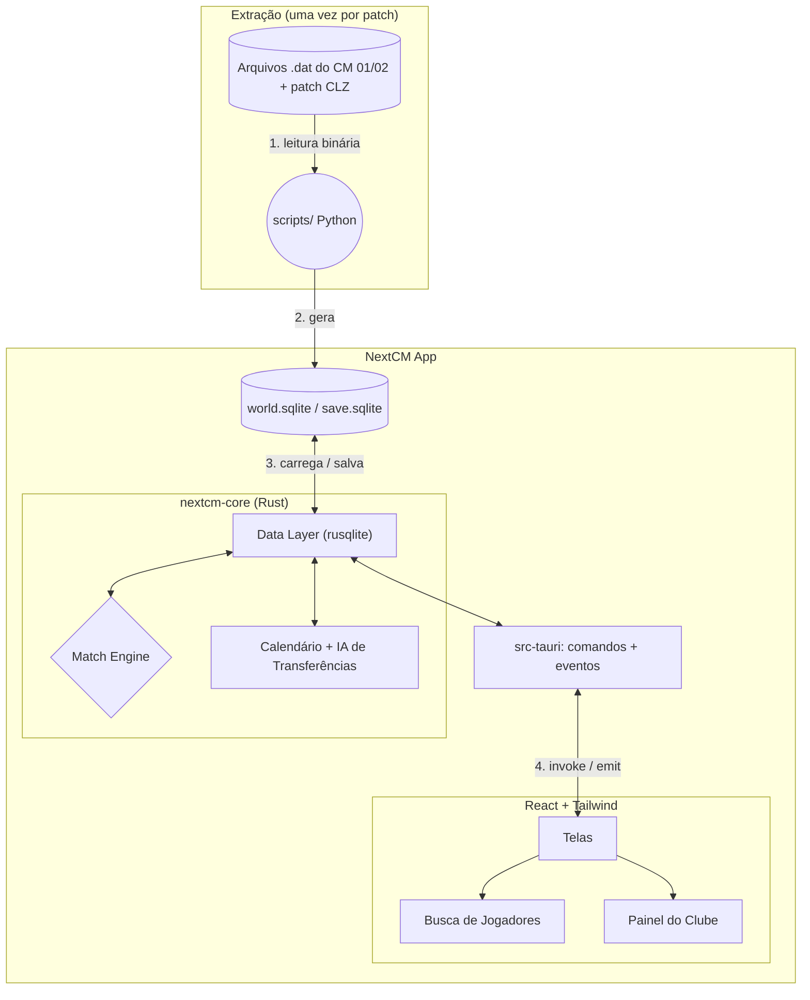

# 🚀 NextCM - Documento Oficial de Arquitetura e Roadmap

Este documento serve como o **GDD (Game Design Document)** e **Plano de Engenharia** para recriarmos a base do Championship Manager 01/02 com tecnologia moderna. Atualizaremos este arquivo conforme avançamos.

---

## 🧱 0. Decisões de Stack (revisadas)

| Camada | Escolha | Por quê |
|---|---|---|
| UI | **React + TypeScript + Vite + Tailwind** | Já está montado em `game/`. Só exibe dados e envia comandos — **nenhuma regra de jogo no front**. |
| Lógica do jogo (core) | **Rust**, num crate próprio `nextcm-core` (biblioteca pura, sem dependência do Tauri) | Performance para simular ~140 mil jogadores por dia, tipagem forte para um modelo de dados grande. Por ser independente do Tauri, dá pra testar com `cargo test` e rodar temporadas inteiras por linha de comando, sem abrir a UI. |
| Desktop / ponte | **Tauri 2** (`game/src-tauri/`) | Entra na **Fase 2** (enciclopédia). Expõe o core para o React via `#[tauri::command]`. Os tipos TS são gerados a partir das structs Rust (`ts-rs` ou `specta`), então front e back nunca divergem. |
| Banco de dados | **SQLite** via `rusqlite` (no Rust) | O mundo importado vira um `world.sqlite`. Novo jogo = cópia desse arquivo; o save é o próprio SQLite. Durante a simulação o estado fica em memória (structs Rust) e é gravado no SQLite ao salvar. |
| Extração | **Python** (`scripts/`) | Lê os `.dat` originais e gera o `world.sqlite`. Roda uma vez por patch. (Pode ser portado pra Rust depois, se quisermos um importador dentro do app.) |

### Estrutura de pastas alvo
```
MeuCM/
├─ core/            # crate nextcm-core (lib): modelos, calendário, match engine, IA
│  └─ src/bin/sim.rs  # CLI: simula N temporadas e imprime tabelas (debug/benchmark)
├─ game/            # React + Vite
│  └─ src-tauri/    # crate do app: comandos Tauri que chamam o core
├─ scripts/         # extrator Python
└─ Cargo.toml       # workspace com core + game/src-tauri
```

### Regras de engenharia
- **Determinismo:** toda aleatoriedade passa por um RNG com *seed* (`rand_chacha::ChaCha8Rng`). Mesmo save + mesma seed = mesmo resultado. Isso torna bugs reproduzíveis e o match engine testável.
- **Simulação fora da thread da UI:** o "Continuar" roda numa thread/`tokio::task` do Rust e emite eventos de progresso (`app.emit`) para o React.
- **Dados estáticos ≠ estado dinâmico:** o que veio do `.dat` (nome, nascimento, nacionalidade) fica separado do que muda (atributos atuais, contrato, moral, clube).
- **Git desde já**, com os `.dat` e o `world.sqlite` no `.gitignore` (são pesados e o banco do patch CLZ não é nosso para redistribuir).

---

## 🎨 0.1 Diretrizes de UX — "tem que parecer o CM 01/02"

O objetivo é a experiência do CM 01/02: o mesmo design, a mesma velocidade e a mesma fluidez. Não queremos cara de dashboard moderno.

- **Visual (referência: CM 01/02 com o tema Coalizão do patch CLZ):** fundo escuro, **coluna esquerda** cinza-azulada (data em amarelo, ◀ ▶, Continuar Jogo, Treinador em rosa, Competições, Nações & Clubes, Procurar, Opções Jogo), **faixa de título colorida** com nome grande (cores da tela ou do clube), **abas escuras** (selecionada com borda amarela), **botões roxos** (Filtros, Atrás/Seguinte, Cancelar/Ok), tabela com cabeçalho roxo e **cores por coluna** (nome branco, clube magenta, nação amarelo, posição laranja), linha selecionada em vermelho, paginação "◀◀ ◀ Pg 1/N ▶ ▶▶" e **diálogo de filtros verde** com opções em caixa amarela. Nomes nas listas como "Sobrenome, Nome"; posições com as siglas em PT (GR, D, AL, MD, M, MA, A + lados D/E/C).
- **Sem enfeite:** sem animações, transições, cards arredondados ou espaçamento grande. A informação vem antes do estilo.
- **Velocidade:** toda navegação deve parecer instantânea (< 100 ms). Consultas pesadas ficam no Rust, com índices no SQLite, e nunca com "loading" piscando.
- **Navegação:** voltar/avançar como no CM, com tudo clicável (jogador → clube → competição → nação).
- **Teclado:** setas para mover na lista, Enter para abrir, Alt+← / Alt+→ para voltar e avançar, Esc para limpar a busca.
- **Teclado:** começar a digitar em qualquer lugar já vai para a busca.
- **Data do jogo e "Continuar Jogo"** sempre visíveis no topo da coluna esquerda. Na Fase 2, o "Continuar Jogo" fica desabilitado.
- **Meta de desempenho medida:** a busca leva de 1 a 45 ms com 144 mil pessoas, graças a colunas pré-calculadas (`ability`, `birth_sort`, `positions`), `ANALYZE` e cache/mmap do SQLite.

## 🏗️ 1. Mapa de Arquitetura



---

## 🔬 2. Formato dos Dados

**Fonte:** os `.dat` de dentro do `CLZ Leagues Patch (DB 25-26) V5.4.rar`, extraídos em `data/raw/clz-25-26/`.
⚠️ A pasta `CLZ Leagues Patch (DB 25-26) V5.4/Data/` instalada no disco **não** tem o banco 25-26: ela foi sobrescrita pelo banco original de 2001 (Flamengo com Vampeta e Zagallo).

- **`index.dat`**: header de 8 bytes + entradas de 67 bytes (`nome[51]`, `id`, `quantidade`, `offset`, `versão`). É a fonte da verdade para contagens e offsets.
- **Strings**: `char[N]` terminadas em `\0`, Windows-1252.
- **Datas** (8 bytes): `short dia_do_ano` (base 0), `short ano`, `int bissexto`. Ano 1900 = desconhecido.
- **Anos com −24:** o patch guarda 2025 como 2001 (o CM 01/02 começa em 2001). O extrator soma 24 (`--year-offset`).
- **IDs**: −1/−2 = nenhum. Atributo 0 = não definido (o jogo gera na hora).
- **Atributos relativos:** 18 atributos técnicos (Antecipação, Cruzamentos, Decisões, Finta, Finalização, Jogo de Mãos, Cabeceamento, Remates Longe, Marcação, Sem Bola, 1x1, Passe, Penáltis, Posicionamento, Reflexos, Desarme, Lançamentos, Criatividade) são 1–20 *relativos* no banco. O jogo os converte em intrínsecos (−125 a 125) e mostra um valor que depende do CA (ver item 7 da sprint).
- IDs não colidem: seleções vêm depois dos clubes (11568+) e competições de seleções depois das de clubes (434+).

| Tabela (id no index) | Registro | Qtde | Observação |
|---|---|---|---|
| Pessoa (6) | 110 B | 144.423 | nomes, nascimento, nacionalidades, clube/cargo, contrato, salário, 8 atributos mentais, ponteiros |
| Non-player (9) | 68 B | 34.094 | CA/PA, reputação, 21 atributos de staff (ordem conferida no `cm0102.exe`; 8 são relativos, ver sprint item 9) |
| Player (10) | 70 B | 110.514 | CA/PA, reputação, 12 posições, 42 atributos 1–20, moral |
| Preferências (22) | 52 B | 144.423 | clubes/pessoas favoritos e odiados (não extraído) |
| Clube / Seleção (0/1) | 581 B | 11.568 / 462 | `division` = liga; `reserve_division` = **estadual** no patch CLZ |
| Competição (12/16) | 107 B | 434 / 24 | continente, nação, reputação |
| Histórico de carreira (17) | 17 B | 662.036 | tem duplicatas (o extrator remove) |

Os layouts completos estão em `scripts/extract.py`. Checagem: `python scripts/validate.py`.

---

## 🛤️ 3. Roadmap em 3 Fases

Primeiro os dados, depois a enciclopédia navegável, só então o jogo. **Nenhuma simulação nas Fases 1 e 2.**

### Fase 1 — Extrator ✅
**Objetivo:** transformar os `.dat` do patch CLZ num `world.sqlite` limpo e confiável.
- ✅ **1.1** `git init` + `.gitignore` (`*.dat`, `*.sqlite`, `node_modules`, `dist`, `target`).
- ✅ **1.2** Ler o `index.dat` (contagens e offsets de cada tabela).
- ✅ **1.3** Nomes: `first_names.dat`, `second_names.dat`, `common_names.dat`.
- ✅ **1.4** Pessoas: as 3 tabelas do `staff.dat` (staff, non-player, player).
- ✅ **1.5** Mundo: `club.dat`, `nation.dat`, `continent.dat`, `city.dat`, `stadium.dat`.
- ✅ **1.6** Competições: `club_comp.dat`, `nation_comp.dat` (+ históricos, se fácil).
- ✅ **1.7** Validação: checagem automática (0 órfãos) + conferência com o `cm0102ed-nick` usando um save de 2030, já que o editor não abre o banco puro. Batem os atributos fixos de jogador (Dirtiness, Handling, Flair, Consistency, Versatility...), os pés, 6 dos 8 mentais, o Flamengo (divisões, estadual, última posição, estádio, status e cores) e os atributos absolutos de staff. Ficha em `docs/conferencia-editor.md` (`python scripts/checklist.py`). Em aberto: Sportsmanship e Temperament aparecem sempre 2–5 pontos abaixo no save (pode ser o jogo mudando com o tempo), e o "Coaching Style" do editor (20) não bate com o nosso Coaching Technique (12).

**Pronto quando:** `python scripts/extract.py` gera o `world.sqlite` e as consultas de validação batem com o editor. ✅

### Fase 2 — Enciclopédia navegável (Tauri) (próxima)
**Objetivo:** abrir o app desktop e navegar por clubes, pessoas e competições. Só leitura.
- **2.1** Adicionar Tauri ao projeto Vite, montar o workspace Cargo (`core/` + `game/src-tauri/`), limpar o template.
- **2.2** `nextcm-core`: structs + consultas ao `world.sqlite` com `rusqlite`; tipos TS gerados (`ts-rs`/`specta`).
- **2.3** Comandos Tauri: `search_people`, `get_player`, `get_staff`, `get_club`, `get_squad`, `list_competitions`, `get_competition`, `get_nation`.
- **2.4** Telas:
  - **Clube:** dados, estádio, elenco e comissão técnica.
  - **Jogador / Staff:** perfil com atributos 1–20, posições, clube, nacionalidade, histórico.
  - **Competição:** clubes participantes (e campeões anteriores, se o histórico estiver extraído).
  - **Nação:** clubes e competições do país.
  - **Busca:** jogadores e staff com filtros (nome, idade, posição, nacionalidade, clube, atributos).
- **2.5** Navegação com links entre tudo (jogador → clube → competição → nação) e voltar/avançar.

**Pronto quando:** dá pra ir de "Brasil" até o perfil de qualquer jogador do Brasileirão clicando, e a busca responde em menos de ~200 ms.

### Fase 3 — Transformar em jogo
Dividida em marcos pequenos. Cada marco termina com algo jogável e testável, e as regras ficam no core em Rust (testes + CLI) antes de ganharem tela. Até o marco 4, só o Brasileirão Série A está "vivo"; as outras ligas ficam paradas.

| Marco | Entrega | Pronto quando |
|---|---|---|
| ✅ **3.1** Novo jogo e tempo | Criar/gravar/carregar jogo, treinador no clube, "Continuar" avança a data, Notícias | Dá para começar um jogo no Palmeiras, avançar uns dias, gravar, fechar e carregar |
| **3.2** Série A jogável | Calendário (turno e returno), Match Engine v1 (força por setor → Poisson, RNG com seed), resultados, classificação real, Próximo/Último Jogo | Uma temporada inteira da Série A até o campeão |
| **3.3** O seu time | Escolher o onze e editar a táctica, condição física, moral, lesões, suspensões | O onze escolhido muda os resultados |
| **3.4** Fim de época | Subidas/descidas, envelhecimento e evolução do CA, contratos, regens; CLI `sim` com 10 épocas | 10 épocas seguidas sem UI, com números plausíveis |
| **3.5** Mais competições | Série B, Copa do Brasil, estaduais, Libertadores, ligas europeias; regulamentos num arquivo de dados por competição | Calendário brasileiro completo numa época |
| **3.6** Mercado | Transferências e empréstimos com IA, finanças, propostas | Clubes compram e vendem entre si |
| **3.7** Polimento | Relato ao vivo do jogo, notícias completas, ofertas de emprego, férias | — |

#### Marco 3.1 — Novo jogo e tempo (detalhe)

**Save**
- Novo jogo = cópia do `world.sqlite` para a pasta de saves: `<app data>/saves/<nome>.sqlite` no Tauri, `data/saves/` na ponte de dev. O save é o próprio SQLite, aberto para escrita. O `world.sqlite` original nunca muda.
- Tabelas novas no save: `game` (uma linha: versão do formato, nome do jogo, data atual, seed do RNG, id do treinador e do clube) e `news` (data, tipo, título, texto, lida).
- O estado em memória (`Game` no core) é gravado no SQLite ao "Gravar Jogo". Sair sem gravar descarta o que mudou desde a última gravação.
- O formato tem número de versão; um save de versão antiga é recusado com mensagem clara, até existir migração.

**Treinador**
- Como no CM, o treinador entra no banco como pessoa nova (nome, data de nascimento, nacionalidade), com cargo Treinador no clube escolhido. O treinador anterior fica sem clube.

**Tempo**
- O jogo começa em 1.7.2025 (data do patch). "Continuar Jogo" avança um dia. Sem jogos no 3.1, o dia só muda a data e entrega as notícias do dia.
- O avanço roda no core; a UI só recebe a data e as notícias novas. No 3.2 passa a rodar em thread com eventos de progresso.

**Telas**
- **Início** (quando não há jogo aberto), com Novo Jogo, Carregar Jogo, Explorar Base de Dados (a enciclopédia da Fase 2) e Opções.
- **Novo Jogo**: nome, apelido, nascimento e nacionalidade do treinador; depois a escolha do clube (nação → clube, com reputação e divisão).
- **Carregar Jogo**: lista de saves com nome, clube, data do jogo e data da gravação.
- **Notícias para <treinador>**: abas Todas/Mensagens/Competições/Lesões e Suspensões, lista e texto da notícia, Ler Próxima. No 3.1 só há a mensagem de boas-vindas da direção.
- **Coluna esquerda**: data do jogo, "Continuar Jogo" ligado, botão do treinador (rosa, com o nome) e o menu amarelo do CM: Plantel, Tácticas, Notícias, Pesquisa, Historial, Gravar Jogo, Retirar-se.

**Core e testes**
- `core/src/game/`: criar, abrir, gravar e avançar o dia. Testes: novo jogo cria o save e põe o treinador no clube, gravar e reabrir dá o mesmo estado, avançar N dias dá a data certa.
- `core/src/bin/sim.rs` (início da CLI): cria um jogo temporário e avança N dias.

**Feito (3.1):** `core/src/game.rs` (save, treinador, notícias), `core/src/date.rs` (datas sem dependências), `core/src/session.rs` (mundo base + jogo aberto, usado pelo Tauri e pela ponte de dev), CLI `cargo run -p nextcm-core --bin sim -- <clube> <dias>` (criar o jogo leva ~0,5 s; 365 dias, ~8 ms). Telas: menu inicial, Novo Jogo (treinador → clube), Carregar Jogo, Notícias, menu amarelo do treinador (Plantel, Tácticas, Historial, Notícias, Pesquisa, Perfil, Gravar Jogo, Sair para o Menu) e aviso de alterações por gravar ao sair. Saves de dev em `data/saves/`, saves do app em `<app data>/saves/`.

---

## 📋 4. Próxima Sprint (Fase 2)

1. [x] Ordem dos 21 atributos de staff conferida no `cm0102.exe` (`database_non_player_to_attribute_vector`, 0x53a8b0) e no editor. Os cargos 12–15 continuam sem conferência.
2. [x] Tauri adicionado ao `game/` (`npm run tauri dev`).
3. [x] Workspace Cargo com `core/` (nextcm-core) e `game/src-tauri/`.
4. [x] Comandos `search_people` e `list_nations` + tela de busca (nome sem acento, tipo, nação, posição, idade, ordenação, paginação).
5. [x] Visual Studio Build Tools instalado; `cargo test -p nextcm-core` (11 testes) e `npm run tauri dev` funcionando.
6. [x] Perfil de Jogador/Staff (abas Perfil, Contrato, Historial; cores do clube na faixa), aberto com duplo clique/Enter; navegação ◀ ▶ / Atrás-Seguinte / Alt+setas.
7. [x] Atributos "intrínsecos" convertidos para os valores que o CM mostra (`core/src/attributes.rs`; os valores do banco seguem em `rawAttributes`). O algoritmo foi lido do `cm0102.exe` 3.9.68: `intr = (10 × banco − CA) / 2`, duas normalizações "especialista × generalista" (0x538ec0, 0x538bc0) e a fórmula de exibição `x = (2·intr + CA)/20 + 10`, `(x²/10 + x)/3` (0x544380), que confere com o fórum champman0102 e o CMScoutIntrinsic. Yamal: Finalização 11 → 16 e Remates Longe 2 → 8. No jogo aparecem 18 e 9, porque o CM simula ~6 meses (treino, CA) antes da 1ª tela.
9. [x] Conversão dos atributos de staff (`displayed_staff_attributes` em `core/src/attributes.rs`). Ao criar o jogo, 8 atributos (Coaching GKs, Coaching, Judgement, Judging Potential, Man Handling, Motivating, Physiotherapy e Tactics) viram intrínsecos com `(10·v − CA)/2` (0x538ac6), sem as normalizações dos jogadores. A exibição (`non_player_attribute_rating`, 0x544410) usa a mesma fórmula dos jogadores, então o CA se cancela: `x = 10 + v/2`. Guardiola: Coaching 5 → 9. Os outros 13 são mostrados como estão no banco. Ainda falta conferir com um save tirado logo no início de um jogo novo.
8. [x] Tela de Clube: plantel em 2 colunas (Vêr jogadores/staff, Critério posição/nome/número/idade/habilidade) e Informação Geral; clube clicável na pesquisa, no perfil e nos rivais.
9. [x] Telas Competições (por continente), Competição (clubes e historial de campeões), Nações & Clubes e Nação (clubes por divisão, competições, seleção); botões da coluna ligados e links entre todas as telas.
10. [x] Fechar a Fase 2: o critério "do Brasil até qualquer jogador do Brasileirão só clicando" foi conferido (Nações & Clubes → Brazil → Palmeiras → Veiga → Brazil, e Competições → Sul Americanas → Brazil → Série A → clube → jogador). Ajustes: o botão **Competições** abre o menu amarelo em cascata do CM (Internacionais, Internacionais-Clubes, continentes → nações → competições; "Todas as Competições" abre a tela antiga). A nação no perfil virou link, as listas de nações e competições ficam em cache (sem "Nada para mostrar" piscando) e a faixa de título tem contorno preto e azul-ciano nas competições, como no CM.
11. [x] Telas que só dependem do banco:
    - **Tácticas** (clube → Tácticas): a formação preferida do treinador principal (`preferred_formation`, na ordem da lista do cm0102ed: 0 = não definida, 1 = 5-3-2 Líbero, 2 = 5-3-2, 3 = 4-4-2, 4 = 4-3-3, 5 = 4-2-4, 6 = 3-5-2, 7 = 4-1-2-1-2, 8 = 4-5-1, 9 = 3-4-3). O onze é escolhido em `core/src/tactics.rs` pelo melhor par função × jogador (nota de posição e lado × CA), mais 7 suplentes com um GR. Tem a lista e o campo da "Vista Geral". Editar a táctica fica para a Fase 3.5.
    - **Historial do clube** (clube → Historial): títulos e vices por competição, tirados do historial das competições, e a posição da época anterior.
    - **Competição → Classificação:** tabela de pré-temporada, toda a zero e em ordem alfabética.
    - Reputação actual e mundial no perfil do staff.
12. [x] **Opções Jogo → Definições do Jogo** (diálogo verde do CM): Moeda (€, £, $, R$, câmbio aproximado do início de 25/26), Remunerações (semanais/mensais/anuais), Tipos de Letra dos títulos, Modo Ecrã (completo/em janela; no Tauri usa `setFullscreen`), cor da coluna esquerda (5 cores prontas ou uma escolhida, com relevos calculados a partir dela) e fundo (padrão, liso ou imagem própria reduzida para 1920 px, com escurecimento). Fica guardado no `localStorage` (`game/src/settings.ts`). Som e Auto Gravação aparecem desabilitados até a Fase 3.

> **Windows:** o Rust precisa do linker do MSVC. No Git Bash, o `link` do próprio Git atrapalha; rode `cargo` pelo PowerShell.
> **UI no navegador (sem Tauri):** `cargo run -p nextcm-core --example dev_bridge` (porta 1421) + `npm run dev` em `game/`. O Vite repassa `/invoke/*` para a ponte, que expõe os mesmos comandos. Só para desenvolvimento.
> Tipos TS em `game/src/bindings/` são gerados pelo `cargo test -p nextcm-core` (ts-rs) — não editar à mão.
