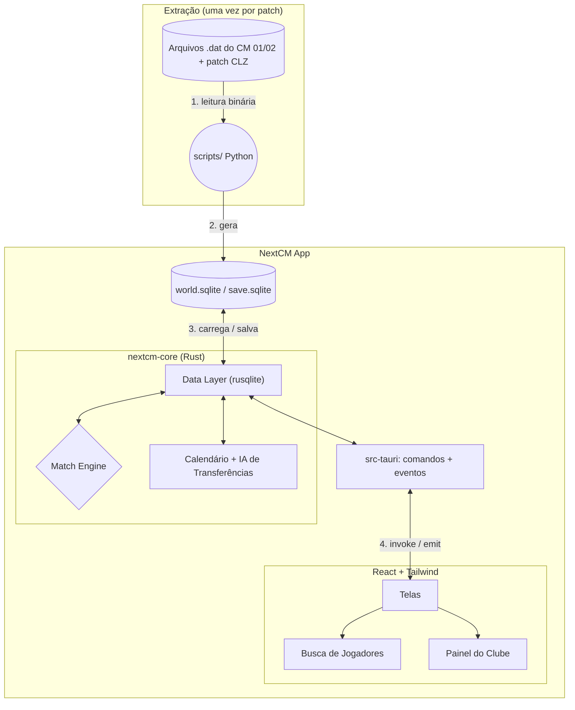

# 🚀 NextCM - Documento Oficial de Arquitetura e Roadmap

Este documento serve como o **GDD (Game Design Document)** e **Plano de Engenharia** para recriarmos a base do Championship Manager 01/02 com tecnologia moderna. Atualizaremos este arquivo conforme avançamos.

---

## 🧱 0. Decisões de Stack (revisadas)

| Camada | Escolha | Por quê |
|---|---|---|
| UI | **React + TypeScript + Vite + Tailwind** | Já está montado em `game/`. Só exibe dados e envia comandos — **nenhuma regra de jogo no front**. |
| Lógica do jogo (core) | **Rust**, num crate próprio `nextcm-core` (biblioteca pura, sem dependência do Tauri) | Performance para simular ~140 mil jogadores por dia, tipagem forte para um modelo de dados grande. Por ser independente do Tauri, dá pra testar com `cargo test` e rodar temporadas inteiras por linha de comando, sem abrir a UI. |
| Desktop / ponte | **Tauri 2** (`game/src-tauri/`) | Entra na **Fase 2** (enciclopédia). Expõe o core para o React via `#[tauri::command]`. Os tipos TS são gerados a partir das structs Rust (`ts-rs` ou `specta`), então front e back nunca divergem. |
| Banco de dados | **SQLite** via `rusqlite` (no Rust) | O mundo importado vira um `world.sqlite`. Novo jogo = cópia desse arquivo; o save é o próprio SQLite. Durante a simulação o estado fica em memória (structs Rust) e é gravado no SQLite ao salvar. |
| Extração | **Python** (`scripts/`) | Lê os `.dat` originais e gera o `world.sqlite`. Roda uma vez por patch. (Pode ser portado pra Rust depois, se quisermos um importador dentro do app.) |

### Estrutura de pastas alvo
```
MeuCM/
├─ core/            # crate nextcm-core (lib): modelos, calendário, match engine, IA
│  └─ src/bin/sim.rs  # CLI: simula N temporadas e imprime tabelas (debug/benchmark)
├─ game/            # React + Vite
│  └─ src-tauri/    # crate do app: comandos Tauri que chamam o core
├─ scripts/         # extrator Python
└─ Cargo.toml       # workspace com core + game/src-tauri
```

### Regras de engenharia
- **Determinismo:** toda aleatoriedade passa por um RNG com *seed* (`rand_chacha::ChaCha8Rng`). Mesmo save + mesma seed = mesmo resultado. Isso torna bugs reproduzíveis e o match engine testável.
- **Simulação fora da thread da UI:** o "Continuar" roda numa thread/`tokio::task` do Rust e emite eventos de progresso (`app.emit`) para o React.
- **Dados estáticos ≠ estado dinâmico:** o que veio do `.dat` (nome, nascimento, nacionalidade) fica separado do que muda (atributos atuais, contrato, moral, clube).
- **Git desde já**, com os `.dat` e o `world.sqlite` no `.gitignore` (são pesados e o banco do patch CLZ não é nosso para redistribuir).

---

## 🎨 0.1 Diretrizes de UX — "tem que parecer o CM 01/02"

O objetivo é a experiência do CM 01/02: o mesmo design, a mesma velocidade e a mesma fluidez. Não queremos cara de dashboard moderno.

- **Visual (referência: CM 01/02 com o tema Coalizão do patch CLZ):** fundo escuro, **coluna esquerda** cinza-azulada (data em amarelo, ◀ ▶, Continuar Jogo, Treinador em rosa, Competições, Nações & Clubes, Procurar, Opções Jogo), **faixa de título colorida** com nome grande (cores da tela ou do clube), **abas escuras** (selecionada com borda amarela), **botões roxos** (Filtros, Atrás/Seguinte, Cancelar/Ok), tabela com cabeçalho roxo e **cores por coluna** (nome branco, clube magenta, nação amarelo, posição laranja), linha selecionada em vermelho, paginação "◀◀ ◀ Pg 1/N ▶ ▶▶" e **diálogo de filtros verde** com opções em caixa amarela. Nomes nas listas como "Sobrenome, Nome"; posições com as siglas em PT (GR, D, AL, MD, M, MA, A + lados D/E/C).
- **Sem enfeite:** sem animações, transições, cards arredondados ou espaçamento grande. A informação vem antes do estilo.
- **Velocidade:** toda navegação deve parecer instantânea (< 100 ms). Consultas pesadas ficam no Rust, com índices no SQLite, e nunca com "loading" piscando.
- **Navegação:** voltar/avançar como no CM, com tudo clicável (jogador → clube → competição → nação).
- **Teclado:** setas para mover na lista, Enter para abrir, Alt+← / Alt+→ para voltar e avançar, Esc para limpar a busca.
- **Teclado:** começar a digitar em qualquer lugar já vai para a busca.
- **Data do jogo e "Continuar Jogo"** sempre visíveis no topo da coluna esquerda. Na Fase 2, o "Continuar Jogo" fica desabilitado.
- **Meta de desempenho medida:** a busca leva de 1 a 45 ms com 144 mil pessoas, graças a colunas pré-calculadas (`ability`, `birth_sort`, `positions`), `ANALYZE` e cache/mmap do SQLite.

## 🏗️ 1. Mapa de Arquitetura



---

## 🔬 2. Formato dos Dados

**Fonte:** os `.dat` de dentro do `CLZ Leagues Patch (DB 25-26) V5.4.rar`, extraídos em `data/raw/clz-25-26/`.
⚠️ A pasta `CLZ Leagues Patch (DB 25-26) V5.4/Data/` instalada no disco **não** tem o banco 25-26: ela foi sobrescrita pelo banco original de 2001 (Flamengo com Vampeta e Zagallo).

- **`index.dat`**: header de 8 bytes + entradas de 67 bytes (`nome[51]`, `id`, `quantidade`, `offset`, `versão`). É a fonte da verdade para contagens e offsets.
- **Strings**: `char[N]` terminadas em `\0`, Windows-1252.
- **Datas** (8 bytes): `short dia_do_ano` (base 0), `short ano`, `int bissexto`. Ano 1900 = desconhecido.
- **Anos com −24:** o patch guarda 2025 como 2001 (o CM 01/02 começa em 2001). O extrator soma 24 (`--year-offset`).
- **IDs**: −1/−2 = nenhum. Atributo 0 = não definido (o jogo gera na hora).
- **Atributos relativos:** 18 atributos técnicos (Antecipação, Cruzamentos, Decisões, Finta, Finalização, Jogo de Mãos, Cabeceamento, Remates Longe, Marcação, Sem Bola, 1x1, Passe, Penáltis, Posicionamento, Reflexos, Desarme, Lançamentos, Criatividade) são 1–20 *relativos* no banco. O jogo os converte em intrínsecos (−125 a 125) e mostra um valor que depende do CA (ver item 7 da sprint).
- IDs não colidem: seleções vêm depois dos clubes (11568+) e competições de seleções depois das de clubes (434+).

| Tabela (id no index) | Registro | Qtde | Observação |
|---|---|---|---|
| Pessoa (6) | 110 B | 144.423 | nomes, nascimento, nacionalidades, clube/cargo, contrato, salário, 8 atributos mentais, ponteiros |
| Non-player (9) | 68 B | 34.094 | CA/PA, reputação, 21 atributos de staff (ordem conferida no `cm0102.exe`; 8 são relativos, ver sprint item 9) |
| Player (10) | 70 B | 110.514 | CA/PA, reputação, 12 posições, 42 atributos 1–20, moral |
| Preferências (22) | 52 B | 144.423 | clubes/pessoas favoritos e odiados (não extraído) |
| Clube / Seleção (0/1) | 581 B | 11.568 / 462 | `division` = liga; `reserve_division` = **estadual** no patch CLZ |
| Competição (12/16) | 107 B | 434 / 24 | continente, nação, reputação |
| Histórico de carreira (17) | 17 B | 662.036 | tem duplicatas (o extrator remove) |

Os layouts completos estão em `scripts/extract.py`. Checagem: `python scripts/validate.py`.

---

## 🛤️ 3. Roadmap em 3 Fases

Primeiro os dados, depois a enciclopédia navegável, só então o jogo. **Nenhuma simulação nas Fases 1 e 2.**

### Fase 1 — Extrator ✅
**Objetivo:** transformar os `.dat` do patch CLZ num `world.sqlite` limpo e confiável.
- ✅ **1.1** `git init` + `.gitignore` (`*.dat`, `*.sqlite`, `node_modules`, `dist`, `target`).
- ✅ **1.2** Ler o `index.dat` (contagens e offsets de cada tabela).
- ✅ **1.3** Nomes: `first_names.dat`, `second_names.dat`, `common_names.dat`.
- ✅ **1.4** Pessoas: as 3 tabelas do `staff.dat` (staff, non-player, player).
- ✅ **1.5** Mundo: `club.dat`, `nation.dat`, `continent.dat`, `city.dat`, `stadium.dat`.
- ✅ **1.6** Competições: `club_comp.dat`, `nation_comp.dat` (+ históricos, se fácil).
- ✅ **1.7** Validação: checagem automática (0 órfãos) + conferência com o `cm0102ed-nick` usando um save de 2030, já que o editor não abre o banco puro. Batem os atributos fixos de jogador (Dirtiness, Handling, Flair, Consistency, Versatility...), os pés, 6 dos 8 mentais, o Flamengo (divisões, estadual, última posição, estádio, status e cores) e os atributos absolutos de staff. Ficha em `docs/conferencia-editor.md` (`python scripts/checklist.py`). Em aberto: Sportsmanship e Temperament aparecem sempre 2–5 pontos abaixo no save (pode ser o jogo mudando com o tempo), e o "Coaching Style" do editor (20) não bate com o nosso Coaching Technique (12).

**Pronto quando:** `python scripts/extract.py` gera o `world.sqlite` e as consultas de validação batem com o editor. ✅

### Fase 2 — Enciclopédia navegável (Tauri) (próxima)
**Objetivo:** abrir o app desktop e navegar por clubes, pessoas e competições. Só leitura.
- **2.1** Adicionar Tauri ao projeto Vite, montar o workspace Cargo (`core/` + `game/src-tauri/`), limpar o template.
- **2.2** `nextcm-core`: structs + consultas ao `world.sqlite` com `rusqlite`; tipos TS gerados (`ts-rs`/`specta`).
- **2.3** Comandos Tauri: `search_people`, `get_player`, `get_staff`, `get_club`, `get_squad`, `list_competitions`, `get_competition`, `get_nation`.
- **2.4** Telas:
  - **Clube:** dados, estádio, elenco e comissão técnica.
  - **Jogador / Staff:** perfil com atributos 1–20, posições, clube, nacionalidade, histórico.
  - **Competição:** clubes participantes (e campeões anteriores, se o histórico estiver extraído).
  - **Nação:** clubes e competições do país.
  - **Busca:** jogadores e staff com filtros (nome, idade, posição, nacionalidade, clube, atributos).
- **2.5** Navegação com links entre tudo (jogador → clube → competição → nação) e voltar/avançar.

**Pronto quando:** dá pra ir de "Brasil" até o perfil de qualquer jogador do Brasileirão clicando, e a busca responde em menos de ~200 ms.

### Fase 3 — Transformar em jogo
Dividida em marcos pequenos. Cada marco termina com algo jogável e testável, e as regras ficam no core em Rust (testes + CLI) antes de ganharem tela. Até o marco 3.5, só o Brasileirão Série A está "vivo"; as outras ligas entram no 3.6.

| Marco | Entrega | Pronto quando |
|---|---|---|
| ✅ **3.1** Novo jogo e tempo | Criar/gravar/carregar jogo, treinador no clube, "Continuar" avança a data, Notícias | Dá para começar um jogo no Palmeiras, avançar uns dias, gravar, fechar e carregar |
| ✅ **3.2** Série A jogável | Calendário (turno e returno), Match Engine v1 (força por setor → Poisson, RNG com seed), resultados, classificação real, Próximo/Último Jogo | Uma temporada inteira da Série A até o campeão |
| ✅ **3.3** O seu time | Escolher o onze, os suplentes e editar a táctica (formação, funções, instruções à equipa como no diálogo do CM), condição física, moral, lesões, suspensões | O onze e a táctica escolhidos mudam os resultados |
| ✅ **3.4** Dia de jogo | Match Engine v2 por eventos (remates, defesas, golos, cartões, substituições, minuto a minuto, mesma seed = mesmo jogo) e a tela da partida do CM: placar e relógio, relato em texto com velocidade ajustável, estatísticas, escalações; intervalo com mudança de táctica e substituições; resultados da jornada no fim | Ver um jogo do Palmeiras do início ao fim, mexer na equipa ao intervalo, e as médias do 3.2 (golos, vantagem em casa) continuam a bater na CLI |
| ✅ **3.5** Fim de época | Subidas/descidas, envelhecimento e evolução do CA, contratos, regens; CLI `sim` com 10 épocas | 10 épocas seguidas sem UI, com números plausíveis |
| ✅ **3.6** Mais competições | Época no ano civil; Séries C e D, Copa do Brasil, estaduais, Libertadores e Sul-Americana; regulamentos num arquivo de dados por competição. As ligas europeias passam para um marco seguinte | Calendário brasileiro completo numa época |
| ✅ **3.7** Mundo | Ligas de Inglaterra, Espanha, Itália, Alemanha, França, Portugal, Holanda, Argentina e Arábia Saudita (1ª e 2ª divisão), Liga dos Campeões e Liga Europa; épocas de agosto a maio ao lado do ano civil | Uma época europeia inteira com campeões, subidas e descidas e a final da Liga dos Campeões |
| ✅ **3.8** Mercado | Transferências e empréstimos (IA e treinador) nas janelas reais, renovações negociadas, finanças completas, orçamentos e despedimento | Clubes compram e vendem entre si com números plausíveis; o treinador compra, vende, renova e vê as finanças |
| ✅ **3.9** Personalidade | Os atributos ocultos que ainda não fazem nada (Ambição, Lealdade, Adaptabilidade, Versatilidade, Desportivismo, Temperamento) passam a contar no mercado, no motor e na moral | As médias do motor e do mercado continuam na CLI e cada atributo tem um efeito testado |
| ✅ **3.10** Olheiros e conhecimento | Atributos escondidos como no CM (o clube só vê o que conhece), observar jogadores, designar olheiros (clube, próximo adversário, jovens, país, região), listas Olheiro #1–#7, orçamento limitado para quem a direção não conhece, relatórios do médico e do preparador físico | Um jogador europeu desconhecido aparece com "-", é observado, o relatório chega e a direção passa a autorizar a proposta inteira |
| ✅ **3.11** Direcção e Federação | A tela Confiança da Direcção com o texto do CM; Reunião com a Direcção (expandir o estádio, investir nas camadas jovens, mais fundos para transferências e salários, mais tempo); Reunião com a Federação (queixas sobre a arbitragem, pedir adiamento de jogo) | Um pedido à direção é aceite ou recusado pela confiança e pelas finanças, e o efeito aparece (orçamento, estádio, juniores) |
| **3.12** Empregos e gestão do plantel | Informação de Empregos (procurar e aceitar clubes, despedimentos na IA), equipa de reservas, Disciplinar Jogador, elogiar e criticar jogadores na imprensa, conferências de imprensa antes e depois dos jogos (ou mandar o adjunto) | Despedido, o treinador encontra outro clube e continua o jogo; um castigo, um elogio ou uma resposta na conferência muda a moral pela personalidade |
| **3.13** Polimento | Notícias completas, férias, Auto Gravação, os ajustes pelos prints do 3.8 (menu Acção, proposta em tela inteira, Prémios e Cláusulas do contrato) | — |
| **3.14** Palestras | Discurso aos jogadores como no FM08: antes do jogo, ao intervalo, no fim e a quem entra; a reação de cada um pela personalidade e pela situação do jogo muda a moral e a motivação na partida | Uma palestra boa ou má muda a moral e o rendimento de forma visível, sem tirar o motor das médias na CLI |
| **3.15** Editor de jogos salvos | Abrir um save fechado a partir do menu inicial e editar jogadores, staff e clubes, com a validação no core | Mudar um atributo e um saldo, gravar, carregar o jogo e ver as mudanças |

#### Marco 3.1 — Novo jogo e tempo (detalhe)

**Save**
- Novo jogo = cópia do `world.sqlite` para a pasta de saves: `<app data>/saves/<nome>.sqlite` no Tauri, `data/saves/` na ponte de dev. O save é o próprio SQLite, aberto para escrita. O `world.sqlite` original nunca muda.
- Tabelas novas no save: `game` (uma linha: versão do formato, nome do jogo, data atual, seed do RNG, id do treinador e do clube) e `news` (data, tipo, título, texto, lida).
- O estado em memória (`Game` no core) é gravado no SQLite ao "Gravar Jogo". Sair sem gravar descarta o que mudou desde a última gravação.
- O formato tem número de versão; um save de versão antiga é recusado com mensagem clara, até existir migração.

**Treinador**
- Como no CM, o treinador entra no banco como pessoa nova (nome, data de nascimento, nacionalidade), com cargo Treinador no clube escolhido. O treinador anterior fica sem clube.

**Tempo**
- O jogo começa em 1.7.2025 (data do patch). "Continuar Jogo" avança um dia. Sem jogos no 3.1, o dia só muda a data e entrega as notícias do dia.
- O avanço roda no core; a UI só recebe a data e as notícias novas. No 3.2 passa a rodar em thread com eventos de progresso.

**Telas**
- **Início** (quando não há jogo aberto), com Novo Jogo, Carregar Jogo, Explorar Base de Dados (a enciclopédia da Fase 2) e Opções.
- **Novo Jogo**: nome, apelido, nascimento e nacionalidade do treinador; depois a escolha do clube (nação → clube, com reputação e divisão).
- **Carregar Jogo**: lista de saves com nome, clube, data do jogo e data da gravação.
- **Notícias para <treinador>**: abas Todas/Mensagens/Competições/Lesões e Suspensões, lista e texto da notícia, Ler Próxima. No 3.1 só há a mensagem de boas-vindas da direção.
- **Coluna esquerda**: data do jogo, "Continuar Jogo" ligado, botão do treinador (rosa, com o nome) e o menu amarelo do CM: Plantel, Tácticas, Notícias, Pesquisa, Historial, Gravar Jogo, Retirar-se.

**Core e testes**
- `core/src/game/`: criar, abrir, gravar e avançar o dia. Testes: novo jogo cria o save e põe o treinador no clube, gravar e reabrir dá o mesmo estado, avançar N dias dá a data certa.
- `core/src/bin/sim.rs` (início da CLI): cria um jogo temporário e avança N dias.

**Feito (3.1):** `core/src/game.rs` (save, treinador, notícias), `core/src/date.rs` (datas sem dependências), `core/src/session.rs` (mundo base + jogo aberto, usado pelo Tauri e pela ponte de dev), CLI `cargo run -p nextcm-core --bin sim -- <clube> <dias>` (criar o jogo leva ~0,5 s; 365 dias, ~8 ms). Telas: menu inicial, Novo Jogo (treinador → clube), Carregar Jogo, Notícias, menu amarelo do treinador (Plantel, Tácticas, Historial, Notícias, Pesquisa, Perfil, Gravar Jogo, Sair para o Menu) e aviso de alterações por gravar ao sair. Saves de dev em `data/saves/`, saves do app em `<app data>/saves/`.


#### Marco 3.2 — Série A jogável (detalhe)

**Calendário**
- Só a Série A (`division_id = 65`, 20 clubes) está viva; as outras ligas continuam paradas até o 3.6.
- Turno e returno pelo método do círculo (38 jornadas, cada clube 19 vezes em casa); o returno repete o turno com o mando trocado. A ordem dos clubes é sorteada com a seed do jogo, então cada jogo novo tem um calendário diferente.
- Jornadas aos fins de semana a partir do primeiro sábado de agosto (2.8.2025): metade dos jogos ao sábado, metade ao domingo. Pausa de fim de ano sem jornadas entre 20.12 e 17.1. A época acaba em maio de 2026.
- Tabela nova no save, `fixtures` (competição, jornada, data, casa, fora, golos). `SAVE_VERSION` passa a 2; saves do 3.1 são recusados com mensagem.

**Match Engine v1** (`core/src/engine.rs`)
- Força por setor (GR, defesa, meio, ataque): média do CA dos titulares de `World::get_club_tactics`, ajustado pela nota na função (inteiro com 20, 95% com 15, 62–88% fora da posição).
- Golos esperados: `base × (ataque ÷ defesa adversária)^3 × (2 × posse do meio-campo)^1,5`, com base 1,42 em casa e 0,92 fora. Golos sorteados por Poisson.
- RNG `ChaCha8Rng` de cada partida = seed do jogo misturada com o id da partida: o resultado não depende da ordem em que os jogos são simulados.

**Tempo e notícias**
- `Game::advance_day` joga as partidas do dia, guarda os resultados e gera notícias: o resultado do jogo do treinador (com a posição na tabela) e, no fim da liga, o campeão (com a posição final do treinador). Ao criar o jogo, notícia com o calendário e o primeiro adversário.
- "Continuar Jogo" (`Game::advance_to_next_event`) avança até haver notícia, até à véspera do próximo jogo do treinador (para ver o Próximo Jogo) ou no máximo 6 semanas.

**Classificação**
- Calculada dos resultados (`core/src/league.rs`): J V E D M S P e os últimos 5 resultados. Desempate do Brasileirão: pontos, vitórias, saldo, golos marcados.

**Telas**
- Competição → **Classificação** com os dados reais (o clube do treinador em rosa); abas **Calendário** (uma jornada de cada vez, com ◀ ▶, abre na próxima por jogar) e **Resultados** (jornadas disputadas, da mais recente).
- Clube → **Próximo Jogo** e **Último Jogo** (os dois clubes com as cores, resultado, posição, pontos e forma) e **Calendário** do clube (data, jornada, casa/fora, resultado em V/E/D).

**Core e testes**
- Calendário completo e justo (380 jogos, cada par uma vez em casa de cada um, um jogo por clube por jornada, fins de semana, pausa), classificação e desempates, Poisson com média certa, mesma seed = mesmo resultado.
- Temporada inteira (`full_season_is_deterministic_and_coherent`): duas corridas com a mesma seed dão os mesmos 380 resultados; 38 jogos por clube; soma dos pontos = 3 × jogos com vencedor + 2 × empates; golos marcados = sofridos; Continuar Jogo pára na véspera e depois do 1º jogo.

**Feito (3.2):** `core/src/engine.rs`, `core/src/league.rs`, calendário e partidas em `core/src/game.rs`, comandos `continue_game`, `league_table`, `list_fixtures` e `club_fixtures` (Tauri e ponte de dev). A CLI `cargo run -p nextcm-core --release --bin sim -- [clube] [dias|epoca] [seed] [épocas]` joga a época e imprime a tabela; com várias épocas mostra a média de posição e pontos. Em 20 épocas: 2,57 golos por jogo, 48% vitórias em casa, 24% empates, 28% vitórias fora; Flamengo (o maior CA) com 13 títulos e média de 80 pontos, Palmeiras 3,6º em média, Remo/Chapecoense/Athletico em baixo. Uma época leva ~0,6 s; cada "Continuar Jogo" ~20 ms na ponte de dev. Ajuste em `core/src/tactics.rs`: a escolha do onze truncava a nota fora da posição para 0 e, no empate, ficava com o pior jogador (o Athletico punha um médio de CA 60 a titular); agora desempata pelo CA.

#### Marco 3.3 — O seu time (detalhe)

**Escolha da equipa** (só o clube do treinador; os outros continuam com o adjunto automático)
- Formação (as 10 do CM), 11 titulares, banco fixo de 9 suplentes (SB1–SB9, como no patch CLZ); o resto do plantel fica nas reservas.
- Posições livres: arrastar um titular para um lugar vazio do campo muda a posição dele, e a função sai da zona e da coluna do campo (um avançado posto no meio-campo vira médio). A táctica mexida aparece com "*" (ex.: 4-4-2*); "Repor as posições" volta à formação. A lista dos titulares segue sempre a ordem do CM: GR, defesas (esquerda, direita, centro), médios, avançados.
- Trocar é só arrastando (na lista ou no campo das Tácticas, e no Plantel do clube, que mostra as casas GR, DD… e SB1–SB7 como no CM). Clicar no número ou na casa de um jogador põe/tira da equipa: quem entra vai para a função vazia onde joga melhor, senão para o banco. As mudanças valem na hora; o Cancelar das Tácticas volta ao que estava ao abrir a tela. Jogador fora da posição: a função aparece em laranja.
- "Adjunto escolhe a equipa": volta à escolha automática, refeita antes de cada jogo. Ao mexer na equipa, o adjunto deixa de escolher.
- No dia do jogo, um titular lesionado ou suspenso é trocado pelo adjunto (o melhor suplente para a função, senão das reservas), com notícia.
- Tabelas novas no save: `selection` (formação, instruções, adjunto) e `selection_players` (função → jogador). `SAVE_VERSION` passa a 3.
- Números de camisola únicos: o banco do patch repete números e deixa muitos jogadores sem número; no jogo, quem tem mais CA fica com o número e os outros (e quem não tinha) recebem um número livre sorteado com a seed (guarda-redes preferem 1, 12, 22…).
- Setas de movimento: botão direito e arrastar a partir de um titular desenha a seta tracejada do CM (para cima ataca, para baixo recua; soltar nele próprio apaga). No motor v1, cada seta para a frente dá +1% no ataque e −0,5% na defesa (e o contrário para trás), até o 3.4 lhes dar lances.
- `SAVE_VERSION` 5 (posições livres em `selection_players.x/y`, setas em `run_x/run_y`); saves dos formatos 3 e 4 são migrados ao carregar.
- Interface: casas e abas com o relevo ("entalhe") do CM; Apagar no Carregar Jogo (com confirmação; não apaga o jogo aberto); máscara dd.mm.aaaa na data de nascimento; ecrãs de carregamento ao criar/carregar o jogo e no Continuar Jogo; ecrã "Dia de Jogo" (relógio de 0' a 90' e o resultado) que leva aos Resultados da jornada; a competição abre direto na Classificação (sem a aba Clubes).
- Telas no formato do CM (pelos prints do patch): **Próximo Jogo** e **Último Jogo** do clube ("Adversário (Casa/Fora)", << Data / Data >>, data com "hoje"/"amanhã", local com estádio e cidade, regras, último confronto, tempo e terreno sorteados com a seed por partida, notícias de lesionados/suspensos de cada lado; `Game::match_preview`); **Calendário** do clube ("Época 2025/6", data, adversário, C/F, competição, resultado); **Calendário** da competição como "Jogos da Tarde" (posição de cada clube e o "v"); **Finanças & Info** (País, Estatuto, Finanças por palavra, Estádio e cidade, Lotação, e a lista do Staff). O dia de jogo segue o CM: "Jogos de Hoje" (posições de antes da jornada) → o jogo, com o relógio e o placar nas faixas dos clubes → "Resultados de Hoje" (posições já atualizadas) → a caixa de mensagens. Seguinte, Enter ou o próprio Continuar Jogo avançam cada fase. Os menus da coluna continuam a funcionar: navegar põe o dia de jogo em espera (dá para ir às Tácticas antes do jogo) e o Continuar volta a ele. Fora do dia de jogo, o Continuar abre a caixa de mensagens sempre que há notícias por ler.

**Instruções à Equipa** (o diálogo verde do CM)
- Mentalidade (Defensivo/Normal/Atacante), Passe (Misto/Curto/Directo/Longo), Desarme (Normal/Suave/Duro), Pressão, Defesa em Linha, Contra-Ataque e Defesa Intensa (Não/Sim).
- No motor v1 viram ajustes pequenos (±2 a 6%) na força dos setores; Desarme e Pressão também mexem nos cartões e no cansaço. Os batedores de livres/cantos e o organizador ficam para o 3.4, quando o motor tiver lances.

**Estado dos jogadores** (dos clubes das competições vivas)
- **Condição** (0–100%): cada titular perde 20–28% num jogo (menos com mais Resistência, +3% com Pressão) e recupera 4–9% por dia (Forma Natural). Rende `75% + 25% × condição` no motor. O adjunto (e a IA) só tira do onze quem está abaixo de 60% (um jogo tira no máximo ~31%, então o onze não muda depois de cada jogo).
- **Moral** (1–20, todos começam em 12: o campo do banco está quase sempre vazio): vitória +2, empate +0, derrota −2 para quem jogou e ±1 para o resto do plantel; volta devagar para 12. Rende de 95% a 105%. Nas telas, por palavras: Excelente, Muito Boa, Boa, Razoável, Fraca, Muito Fraca, Péssima.
- **Lesões**: por titular e jogo, ~0,6–1,8% conforme a Propensão a Lesões (≈ 0,3 lesões por jogo); 70% leves (3–14 dias), 25% médias (15–45), 5% graves (46–120). Voltam com 80% de condição.
- **Cartões**: amarelos por Poisson (média ~2 por equipa, mais com Desarme Duro, Agressividade e Maldade), vermelho ~5% por equipa. 3 amarelos = 1 jogo de suspensão (a contagem zera); vermelho = 1 jogo.
- Tudo sorteado com o RNG da partida, depois do resultado: mesma seed = mesma época.
- Tabela nova no save: `player_state` (condição, moral, amarelos, suspensão, lesão até).

**Telas**
- Tácticas editável no clube do treinador: menu Tácticas (formações), Editar (Instruções à Equipa, Adjunto escolhe), lista com titulares, suplentes (roxo) e reservas, condição em %, "Les"/"Sus" em vermelho, nome em vermelho fora da posição.
- Perfil do jogador: Condição e Moral reais; aba **Lesões & Castigos** (lesão e data de regresso, suspensão, amarelos).
- Plantel do clube: "Les"/"Sus" no lugar de "Int".
- Notícias (aba Lesões e Suspensões): lesões e suspensões dos jogadores do treinador e o regresso de uma lesão.

**Core e testes**
- Trocas e validação da escolha (11 diferentes, todos do clube, até 7 suplentes), substituição de indisponíveis, recuperação diária, lesões e cartões com médias plausíveis numa época (CLI `sim`), a época continua determinística, e a escolha do treinador muda os resultados (um onze de reservas perde mais).

**Feito (3.3):** `core/src/squad.rs` (estado dos jogadores: recuperação diária, cansaço, moral, lesões, cartões e suspensões), `core/src/tactics.rs` (instruções, `Selection`, escolha automática que respeita lesões/suspensões/condição, escolha do treinador validada e `cover_unavailable`), motor com condição, moral e instruções (`TeamStrength::with`), save no formato 3. Comandos `preview_tactics` e `set_tactics`; `get_person`, `get_club` e `get_club_tactics` passam pela `Session` e trazem o estado do jogo. Telas: Tácticas editável (trocas na lista ou no campo, formações, Instruções à Equipa, Adjunto escolhe, nome em vermelho fora da posição, condição em cor), aba Lesões & Castigos no perfil, Les/Sus no plantel, notícias de lesão, suspensão, regresso e alterações do adjunto. Em 20 épocas (CLI `sim`): 2,64 golos por jogo, 48% vitórias em casa, Flamengo 12 títulos e 82 pontos de média: o equilíbrio do 3.2 mantém-se.

#### Marco 3.4 — Dia de jogo (detalhe)

**Match Engine v2** (`core/src/live.rs`)
- O jogo corre minuto a minuto. A cada minuto, a força de quem está em campo (`TeamStrength::from_slots`: CA × nota na função × condição × moral, setas e instruções) dá os golos esperados do motor v1 (`engine::expected_goals`); assim as médias do 3.2 continuam a valer, mas o que acontece em campo (cansaço, expulsões, substituições, instruções novas) passa a contar no próprio jogo.
- **Remates:** ~12 por equipa e jogo (mais para quem tem mais golos esperados, `12 × √(xG/1,17)`); cada remate é golo com probabilidade `xG ÷ remates`, senão defesa do GR (36% dos remates vão à baliza) ou falhado/bloqueado. Quem remata é sorteado pela função (avançado 3,2, médio ofensivo 2, médio 1, defesa 0,35) e pela Finalização, Remates de Longe e Cabeceamento; 70% dos golos têm assistência (Passe e Visão). Cantos depois de defesas e remates bloqueados.
- **Faltas e cartões:** ~13 faltas, amarelos por Poisson (1,9 por equipa, mais com Desarme Duro e jogadores com Agressividade + Maldade acima da média), vermelho directo raro; quem já tem amarelo tem cuidado (metade das vezes escapa ao segundo); dois amarelos = vermelho. Cada jogador a menos tira 10% à força da equipa. Sem guarda-redes, o adjunto mete o do banco (no lugar do jogador de campo que menos rende) ou manda alguém para a baliza.
- **Lesões em campo** (0,6–1,8% por jogador e jogo, pela Propensão): o adjunto substitui sempre; sem substituições, o jogador fica a coxear (condição 30%). A gravidade e a duração sorteiam-se no fim do jogo.
- **Cansaço** em campo: 20–28% num jogo inteiro (Resistência), +3% com Pressão; quem entra vem fresco. A condição com que cada um acaba é a que fica para o dia seguinte.
- **Substituições:** 5 por jogo. O adjunto (nos outros clubes e no do treinador quando o adjunto escolhe a equipa) pensa numa troca aos 46', 58', 66', 74' e 82': troca quem mais ganha com a entrada de um suplente fresco (mais de 1%), até 3 tácticas, guardando uma para lesões. Quando o treinador mexe na equipa a meio do jogo, o adjunto deixa de fazer substituições tácticas por ele.
- **Notas** de 1 a 10: 6 ± 0,4 de forma do dia, golo +1, assistência +0,6, defesa do GR +0,25, golo sofrido −0,4 (GR) / −0,15 (defesas), amarelo −0,3, vermelho −1,5; no fim, vitória ±0,3 e +0,4 para GR e defesas sem sofrer golos. "Melhor em campo" no relato.
- O relato (textos com variantes) não gasta o RNG; o RNG da partida é o do v1 (seed do jogo × id da partida).

**Dia de jogo no core**
- Com `watch` ligado (o app), `Game::advance_day` pára no dia do jogo do treinador: os outros jogos já ficam decididos, mas os resultados do dia só entram no calendário, na classificação e nos jogadores no fim (`Game::live_finish`). O "Continuar Jogo" pára aí; gravar a meio do jogo é recusado.
- O jogo do treinador corre por partes (`live_step`), e entre elas ele substitui (`live_substitute`), troca funções (`live_swap`) e muda as instruções (`live_instructions`). Sem mexer em nada, é exatamente o mesmo jogo que sem ver (teste `watched_match_is_the_same_match`). A CLI e os testes correm com `watch` desligado.
- `squad::after_match` passa a receber o que aconteceu em campo (quem jogou e com que condição acabou, amarelos, expulsos, lesionados) em vez de sortear cartões e lesões depois do resultado.
- A notícia do resultado traz os marcadores.

**Tela da partida** (`game/src/components/MatchDay.tsx`)
- Jogos de Hoje → a partida → Resultados de Hoje → caixa de mensagens, como no 3.3.
- No formato do CM 01/02 (pelos prints do patch CLZ). A partida tem a **sua própria coluna**: o minuto em amarelo no topo, ◀ ▶, o botão principal (**Iniciar Jogo** → **Pausa** → **Retomar Jogo**; no intervalo **Recomeçar Jogo**; no fim **Continuar Jogo**), **Tácticas <casa>**, **Tácticas <fora>** e **Velocidade Comentário** (menu amarelo com Muito Rápida, Rápida, Média, Lenta e Muito Lenta, também em Opções Jogo). As Tácticas abrem a qualquer momento, também clicando no nome do clube nas faixas do placar; com o jogo a correr não abrem logo: aparece "à espera que a bola saia…" e a tela abre na primeira paragem (lateral, reposição do GR, falta, cartão, remate, golo, substituição; no máximo 3 minutos depois), e ao sair delas o jogo continua sozinho. A velocidade só se muda com o jogo parado. O jogo só começa no Iniciar Jogo e pára sozinho no intervalo. No fim, o **Melhor em Campo** aparece em destaque no Panorama (nome, clube e nota) e na lista das Classificações Jogadores.
- À direita: as faixas dos clubes com o placar, as abas **Panorama Jogo** (Pontapé Saída / Primeira Parte / Intervalo / Segunda Parte / Final; data e competição a rosa, com "INT 1-0" no intervalo; a frase do relato numa caixa nas cores do clube que joga; durante o jogo, os marcadores com os minutos numa faixa em cima, longe da caixa do relato, e no intervalo e no fim em grande no meio; o placar e os marcadores só mudam quando o relato chega ao "GOLO!"; a posse dos **Últimos 5 min**; árbitro, assistência e tempo), **Estatísticas Jogo** (remates, no alvo, ao lado, cantos, livres, lançamentos, faltas, foras de jogo, passes acertados, cortes e cabeceamentos ganhos, cartões), **Zonas Acção** (onde andou a bola em cada terço, a posse em cada um e o tempo útil) e **Relatório Jogo** (o relato inteiro, por minuto). Em baixo: **Dados <clube>** (por jogador: passes, certos, cortes, ganhos, cabeceamentos, ganhos, assistências, remates, à baliza, condição, nota e golos), **Classificações Jogadores** (as notas), **Últimos Resultados** (os outros jogos do dia no mesmo minuto) e **Classificação Geral** (a tabela com os resultados do dia no minuto em que vai o jogo). Na faixa roxa de baixo, o estádio e a cidade.
- O relato conta cada lance em várias frases ("Veiga procurou López com uma bola na área" → "López cabeceou" → "GOLO!..."), uma de cada vez ao ritmo da velocidade; o relógio só avança quando as frases do minuto foram ditas. Os minutos sem lances têm jogadas de enchimento.
- **Tácticas** a meio do jogo: a mesma tela de Tácticas (as peças estão em `game/src/components/TacticsBoard.tsx`), só com quem está no jogo. No clube do treinador dá para fazer tudo o que se faz fora do jogo: arrastar na lista ou no campo (dois titulares trocam de função; titular com suplente é uma substituição), soltar num lugar vazio do campo (posição livre), setas com o botão direito, menu **Tácticas** (formações pré-definidas e Instruções à Equipa) e **Editar → Repor as posições**. O core usa a mesma `Selection` da tela de Tácticas: `live_preview_tactics` mostra as funções e as notas sem mexer no jogo, e o **Ok** (`live_set_tactics`) aplica tudo de uma vez, recusando quem já saiu, jogadores a mais em campo ou mais de 5 substituições; o **Cancelar** esquece. Antes do pontapé de saída as trocas não contam como substituições. A escolha gravada fora do jogo não muda. A do adversário só se vê.
- O "enchimento" das telas (passes, cortes, cabeceamentos, lançamentos, foras de jogo, zonas, tempo útil e as jogadas sem lance) usa um segundo RNG, só no jogo que o treinador vê: o resultado é igual ao do jogo sem ver, e a CLI dá os mesmos números. O árbitro é um nome inventado (nome e apelido de pessoas da nação do clube da casa) e a assistência sai entre 55% e 98% da lotação do estádio.
- Recarregar a página (dev) a meio do jogo e carregar em Continuar Jogo volta ao jogo onde estava.

**Fica para depois:** batedores de livres, cantos e penáltis e o organizador (o diálogo ainda não os tem; os lances de bola parada não são separados), descontos de tempo, a vista "Com Bola/Sem Bola" e mudar de formação nas Tácticas a meio do jogo, e o jogo guardado a meio (o save só grava fora do jogo).

**Feito (3.4):** `core/src/live.rs` (motor por lances, relato, notas, substituições, `LiveView` para a tela), `engine.rs` reduzido à força das equipas e aos golos esperados, dia de jogo em duas fases em `game.rs`, comandos `live_match`, `live_step`, `live_substitute`, `live_swap`, `live_instructions` e `live_finish` (Tauri e ponte de dev), `GameInfo.live`. Em 20 épocas (CLI `sim`): 2,62 golos por jogo, 49% vitórias em casa, 23% empates; por equipa e jogo 12,3 remates (4,4 à baliza), 4,5 cantos, 15 faltas, 1,84 amarelos, 0,10 vermelhos, 2,5 substituições e 0,12 lesões; Flamengo 10 títulos e 79 pontos de média. Cada minuto ao vivo responde em poucos ms na ponte de dev; uma época na CLI leva ~2,4 s (era ~0,6 s com o v1).

#### Marco 3.5 — Fim de época (detalhe)

**Épocas**
- Uma época vai de 1 de julho a 30 de junho; a época de uma data sai da própria data (julho em diante = ano de início). O `start_year` do mundo acompanha a época, então as idades nas telas avançam (idade a 1 de julho).
- **Série B viva**, como a A (calendário, jogos, condição, lesões, castigos): é o que dá subidas de verdade e deixa um treinador despromovido continuar a jogar. A **Série C** só existe no fim da época: uma tabela de turno e returno calculada com o motor v1 (força dos clubes, sem estado). Da **Série D** sobem 4 por sorteio pesado pela força.
- Classificação, calendário e resultados mostram a época atual; os jogos das épocas passadas ficam no save (último confronto, historial).

**Fim de época (30 de junho)**
- Subidas e descidas: 4 descem da A e sobem 4 da B; 4 e 4 entre B e C; 4 e 4 entre C e D. Atualiza `clubs.division_id`, `last_division_id` e `last_position`.
- Historial: campeão, vice e 3º da A, B e C em `competition_history`, com o ano em que a época acaba (2025/26 → 2026, como os anos que já vêm do patch).
- Contratos que acabam até 30/6 (e os sem data): o clube ordena o plantel pelo CA (até aos 20 anos soma um terço do que ainda pode crescer) e renova com os 25 melhores dos 21 aos 33 anos, os 18 melhores até aos 20 (os outros juniores procuram clube abaixo) e os 16 melhores com 34 ou 35 anos (1 a 4 anos de contrato, menos para os mais velhos); os outros saem livres. No clube do treinador, o adjunto decide pela mesma regra e avisa nas notícias; a negociação chega com o mercado (3.7).
- Reformas a partir dos 34 anos (34: 10%, 35: 20%, 36: 40%, 37: 60%, 38: 80%, 39+: sempre; guarda-redes dois anos depois). Ficam sem clube e numa tabela `retired`.
- Plantéis mínimos: um clube das Séries A–C com menos de 24 jogadores contrata jogadores livres até 27 (primeiro do país, 18–33 anos, CA até 115% da média do plantel, um 2º guarda-redes se faltar; sem guarda-redes livres, fica com o que houver). Provisório até ao mercado do 3.7.
- Notícias: subidas e descidas, renovações e saídas do clube do treinador, reformas.

**Nova época (1 de julho)**: calendários novos da A e da B (sorteados com a seed), notícia do calendário, estado dos jogadores dos clubes que entraram nas ligas vivas.

**Evolução do CA** (todo dia 1, jogadores dos clubes das Séries A–C)
- Por ano: até 21 anos ganha 22–34% da distância ao PA; 22–24, 15%; 25–28, 8%; 29–30 fica; aos 31–32 perde 1,5 e depois 3 × (idade − 32) (guarda-redes dois anos mais tarde). Nunca passa o PA nem desce abaixo de 1. PA aleatório (negativo no banco) fica fixo na primeira vez.
- Jogar conta: com muitos jogos na época cresce até 40% mais, sem jogar 40% menos (jogos contados em `player_state.apps`, a zero a cada época). Determinação e Profissionalismo dão ±20%.
- Cada mês aplica 1/12 do ano, com ruído e arredondamento sorteados com a seed.

**Juniores (regens, 1 de março)**: cada clube das Séries A–C recebe um jogador de 16 anos e, um em cada três clubes, um segundo (~80 por ano): nome e apelido de pessoas da nação do clube, atributos copiados de um jogador real da mesma posição (os atributos do banco são relativos ao CA, então continuam coerentes), CA 25–55, contrato de 3 anos e número livre. O PA sai da reputação do clube, que não muda no save: `(84 + 0,0114 × reputação) × (0,75 a 1,25)`, o PA médio dos 11 melhores medido no patch (Série A ≈ 147, B ≈ 129, C ≈ 115). Tirado do próprio plantel dava uma espiral: cada geração de juniores puxava a seguinte (em 20 épocas o CA dos 18 melhores da A subia de 128 para 147 ou, ancorado no CA, descia para 107). Notícia no clube do treinador.

**Save**: o mundo muda (CA, contratos, divisões, pessoas novas). O SQLite do save fica dentro de uma transação aberta desde o carregamento: **Gravar Jogo** faz o commit e sair sem gravar desfaz tudo, como até aqui. `SAVE_VERSION` 6: `player_state.apps` e a tabela `retired`.

**CLI**: `sim -- <clube> carreira <seed> <épocas>` joga um só jogo por várias épocas seguidas e imprime, por época, o campeão, quem sobe e desce, o CA e a idade médios da A e da B, o tamanho dos plantéis, juniores, reformas e saídas.

**Pronto quando:** 10 épocas seguidas na CLI sem erros, com o CA médio da Série A estável (±5%), idade média entre 25 e 28 anos e plantéis entre 22 e 40 jogadores.


**Feito (3.5):** `core/src/game/season.rs` (fim de época, nova época, evolução do CA, juniores, contratos, reformas, plantéis mínimos e os números da CLI), Série B viva em `game.rs` (`LIVE_LEAGUES`), save numa transação aberta desde o carregamento (Gravar Jogo = commit; sair sem gravar desfaz também as mudanças no mundo), `SAVE_VERSION` 6 com migração do 5. A CLI `cargo run -p nextcm-core --release --bin sim -- 7568 carreira 1 10` joga 10 épocas em ~50 s; mostra também o CA médio dos 18 melhores de cada clube (a força da divisão sem contar os juniores). Resultado com a seed 1:

| | Início | Época 5 | Época 10 | Época 20 |
|---|---|---|---|---|
| CA médio da Série A | 113,4 | 115,7 | 110,4 (−2,6%) | 116,1 |
| CA dos 18 melhores | 128,3 | 128,2 | 125,0 | 132,8 |
| Idade média da A | 25,7 | 26,8 | 25,7 | 25,1 |
| Plantéis da A | 27–42 | 24–32 | 24–27 | 24–29 |

Nas épocas 11–20 a idade desce até 24,0 e volta a 25: é a onda de reformas da geração que vem do patch (muitos jogadores entre os 28 e os 33 anos em 2025), substituída por juniores. O único plantel acima de 40 é um de 42 jogadores que já vem do patch e encolhe com os contratos. Médias de jogo inalteradas (10 épocas de `sim -- 7568 epoca 1 10`: 2,67 golos por jogo, 49% vitórias em casa). Na ponte de dev, na nova época a Série B arranca do zero, o historial da A, B e C ganha 2026 e as idades sobem um ano.

#### Marco 3.6 — Mais competições (detalhe)

Decisões (com o utilizador): a época brasileira passa para o **ano civil**, como no Brasil real; o marco cobre o **Brasil e as continentais** (Libertadores e Sul-Americana); as ligas europeias ficam para um marco seguinte.

**Ano civil**
- A época é o ano: estaduais de janeiro a abril, Séries A–D de abril a dezembro, Copa do Brasil, Libertadores e Sul-Americana a meio da semana. A etiqueta da época passa a ser o ano ("2026").
- **2025 é de transição**: o jogo começa a 1.7.2025 (data do patch) e só a A e a B jogam, de agosto a dezembro, com jornadas ao fim de semana e a meio da semana (38 jornadas em 19 semanas). C e D contam no fim da época como no 3.5.
- **Fim de época** a 20 de dezembro (depois de todas as competições): subidas e descidas, historial de todas as competições vivas, contratos que acabam até 31/12, reformas, plantéis mínimos. **Nova época** a 1 de janeiro: calendários e sorteios. Os contratos que acabam a 30/6 tratam-se a 30/6 (renova ou sai). Juniores continuam a 1 de março; evolução do CA todo dia 1.
- A época de um jogo é o ano da data dele: todas as competições de uma época cabem no ano.

**Regulamentos** (`core/regulations/*.json`, um por competição, embutidos no executável)
- Cada competição tem fases. Uma fase é `league` (pontos corridos, turno só ou turno e returno), `groups` (grupos de N, turno e returno) ou `knockout` (eliminatórias de jogo único ou ida e volta; empate no total vai a penáltis, sem golo fora; a final pode ser em campo neutro).
- Participantes: clubes de uma divisão, de um estadual, os primeiros de outra fase ou de outra competição (ex.: Libertadores = 1º a 5º da A + campeão da Copa do Brasil), ou clubes de outras nações (quotas por nação, sorteio pesado pela reputação entre os da 1ª divisão).
- Datas por **semana ISO e tipo de dia**: `w14` = fim de semana da semana 14 (sábado e domingo), `m15` = meio da semana 15 (quarta e quinta). Assim as datas servem para qualquer ano com os mesmos dias da semana. Fins de semana são das ligas e dos estaduais; cada meio de semana é de uma só competição (ou Libertadores e Sul-Americana juntas, que não partilham clubes), para nenhum clube jogar duas vezes em três dias. Um teste confere isto para a época inteira.

**Competições**
- **Série A e B**: 20 clubes, turno e returno (abril–dezembro). Descem 4.
- **Série C**: 20 clubes em turno único; os 8 primeiros fazem 2 grupos de 4 (turno e returno); os 2 primeiros de cada grupo sobem e os vencedores dos grupos jogam a final. Descem os 4 últimos da 1ª fase.
- **Série D**: 96 clubes em 16 grupos de 6 (turno e returno); os 2 primeiros de cada grupo vão às eliminatórias de ida e volta; os 4 vencedores dos quartos de final sobem.
- **Copa do Brasil**: 64 clubes (A, B, C e os 4 da D com mais reputação). 1ª e 2ª fases em jogo único (em casa do clube de divisão mais baixa); oitavas, quartos, meias e final em ida e volta. O campeão vai à Libertadores.
- **Estaduais** (os 12 "Campeonato X" do patch com clubes: Carioca, Paulista, Mineiro, Gaúcho, Paranaense, Catarinense, Baiano, Pernambucano, Goiano, Nordeste, Norte e Central): turno único; com 12 ou mais clubes os 8 primeiros vão aos quartos, senão os 4 primeiros às meias (jogo único, em casa do mais bem classificado); final em ida e volta. As divisões inferiores dos estaduais continuam paradas.
- **Libertadores**: 32 clubes em 8 grupos de 4; Brasil 6 (1º–5º da A e o campeão da Copa do Brasil, ou o 6º), Argentina 6, Uruguai, Paraguai, Chile, Colômbia e Equador 3, Peru e Bolívia 2, Venezuela 1. Os 2 primeiros de cada grupo vão às oitavas; eliminatórias de ida e volta e final em campo neutro. Sem fases prévias.
- **Sul-Americana**: igual, com o 7º–12º da A e outros clubes das mesmas nações (nunca os que já estão na Libertadores).
- Na época 2026 a Libertadores e a Sul-Americana usam a tabela final da A de 2025; os clubes de fora são escolhidos a cada época (as ligas deles continuam paradas).

**Jogo**
- Todas estas partidas são jogadas com o Match Engine v2; o treinador vê ao vivo as do clube dele. Penáltis no fim do jogo quando a eliminatória fica empatada. Em campo neutro não há vantagem de casa.
- Cartões: os amarelos contam por competição (3 amarelos = 1 jogo de castigo nessa competição); o vermelho também castiga só na competição em que foi visto.
- Notícias: resultado do jogo do treinador em todas as competições (com a fase), sorteios do clube do treinador, campeões.
- Desempenho: ~3 000 jogos por ano no Brasil e nas continentais; uma época na CLI deve ficar abaixo de ~30 s.
- **Plantéis completados**: 92 dos 182 clubes dos estaduais e da Série D vêm do patch com menos de 11 jogadores (55 sem nenhum), e davam resultados de 20-0. Como o CM, o jogo cria jogadores para eles na nova época: até 18 (2 GR, 6 D, 6 M e 4 A no mínimo), com nomes da nação, atributos copiados de um jogador real da posição e CA à medida da reputação do clube (o CA médio dos 11 melhores no patch é ≈ 74,6 + 0,0101 × reputação).
- **Teto dos golos esperados**: os jogos muito desiguais (Série A contra um clube de estadual) não podem dar goleadas de 15. Primeiro foi um teto suave nos golos esperados (achatar acima de 3, teto 5); a recalibração abaixo trocou-o por um teto na vantagem, em logaritmo.

**Telas**
- Competição: abas Classificação (com as fases e os grupos), Calendário (por fase/jornada) e Resultados; eliminatórias com o total e os penáltis.
- Clube: Calendário com todas as competições; Próximo/Último Jogo com a fase ("Oitavas de final · 2ª mão").
- O menu Competições e Nações & Clubes levam às competições vivas como a qualquer outra.

**Save**: `SAVE_VERSION` 7, com as colunas novas em `fixtures` (fase, grupo, eliminatória, mão, campo neutro, penáltis) e a tabela `cards` (amarelos e castigos por competição). Um save do 3.5 sem jogos disputados é migrado e as competições voltam a ser sorteadas no formato novo; com jogos disputados é recusado com mensagem, porque as jornadas que faltam da época de julho a junho não cabem até dezembro.

**Passos**
1. Ano civil, regulamentos e datas por semana; Séries A–D vivas com as fases da C e da D; época de transição 2025; migração do save.
2. Eliminatórias (ida e volta, penáltis, sorteios) e a Copa do Brasil.
3. Estaduais.
4. Libertadores e Sul-Americana (clubes de fora, grupos, campo neutro).
5. Telas, notícias e CLI (`sim -- <clube> carreira` mostra os campeões de todas as competições).

**Pronto quando:** uma época de 2026 inteira na CLI com todas estas competições, sem nenhum clube com dois jogos em menos de 3 dias, e no navegador o Palmeiras joga Paulista, Série A, Copa do Brasil e Libertadores no mesmo ano.

**Feito (3.6):** `core/src/regulation.rs` e os 19 regulamentos em `core/regulations/*.json` (Séries A–D, Copa do Brasil, Libertadores, Sul-Americana e 12 estaduais), `core/src/game/competitions.rs` (participantes, sorteios de grupos e eliminatórias, calendários por fase, penáltis, passagem de fase, campeões e as vistas para a tela), `core/src/game/regen.rs` (jogadores criados: juniores e plantéis completados), fim e nova época no ano civil em `season.rs`, cartões por competição em `squad.rs`, campo neutro e penáltis em `engine.rs`/`live.rs`, comando `competition_stages` (Tauri e ponte de dev). Telas: Classificação por fases (pontos corridos, grupos em duas colunas, eliminatórias com as mãos, o total e os penáltis), Calendário e Resultados por jornada ou ronda, etiqueta da fase nos jogos e "g.p." nos penáltis.

Números (CLI `sim -- 7568 carreira 1 2`): a transição de 2025 em 3,0 s e a época de 2026 inteira (mais de 2 500 jogos, todas as competições com campeão) em 6,5 s. Golos por jogo em 2026: estaduais 2,7–4,0, Série A 2,7–2,9, B 2,2–2,6, C 1,6–2,1, D 2,4, Copa do Brasil 2,5–3,0, Libertadores 2,8–3,3, Sul-Americana 2,5–3,3. As médias da A na transição (`sim -- 7568 epoca 1 10`) continuam em 2,62 golos e 49% de vitórias em casa. O teste `a_full_2026_season` confere que ninguém joga duas vezes em menos de 3 dias, que todas as competições acabam com campeão no historial e que há eliminatórias decididas nos penáltis. No navegador, com o Palmeiras: Paulista (campeão, final em ida e volta), Série A, Copa do Brasil (eliminado nas oitavas) e Libertadores (Grupo A) no mesmo ano.

**Recalibração do motor para equipas desiguais (resolvido):** a partir de 2026 a Série A dava 2,7–2,9 golos por jogo e 7 a 14 goleadas de 6 ou mais por época (na transição, 2,6 e 4 a 7): os promovidos da B são bem mais fracos (CA dos 18 melhores ~108 contra ~127) e a potência 3 do motor (marco 3.2) castigava demasiado essas diferenças. Puxar o joelho do teto para 2,5 ou acelerar o regresso da moral quase não mexia. Com o registo de cada jogo de três carreiras (força dos dois lados e resultado), a vantagem `L = 3·ln(ataque/defesa) + 1,5·ln(2·meio-campo)` mostrou que quase todas as goleadas vêm de `L` acima de 1,5 (golos esperados de 3 a 5): com `L` em 3,5, 1 jogo em 3 acabava com 6+ de diferença. Decisão:
- `engine.rs`: potências mais suaves (K_ATTACK 3 → 2,55, K_MIDFIELD 1,5 → 1,275) e a vantagem achatada por `tanh` até `MAX_EDGE` = 1 (no máximo e ≈ 2,7 vezes a base). Diferenças pequenas ficam quase como estavam; sai o teto suave nos golos esperados.
- `live.rs`: `LEAD_EASE`, quem ganha por 3 ou mais tira o pé (golos esperados a 65%). Era o que mais cortava as goleadas de 6+ sem baixar a média, porque poucos jogos chegam a +3.
- Bases de casa e fora sobem 6% (1,38 → 1,46 e 0,89 → 0,94) para repor a média, que a curva mais suave e o `LEAD_EASE` baixavam para 2,48.

| | Antes | Depois |
|---|---|---|
| `sim -- 7568 epoca 1 10` (Série A da transição) | 2,62 golos, 49% em casa; Flamengo 86 pts de média, o último 19 | 2,58 golos, 49% em casa; Flamengo e Palmeiras 77–78 pts de média, o último 26 |
| Série A 2025 (carreira, seeds 2/3/4) | 2,60 / 2,67 / 2,64; 6, 7 e 4 com 6+ | 2,51 / 2,57 / 2,57; 2, 2 e 0 com 6+ |
| Série A 2026 | 2,95 / 2,79 / 2,74; 14, 13 e 7 com 6+ | 2,69 / 2,74 / 2,55; 1, 1 e 4 com 6+ |
| Estaduais 2026 | 2,5–3,7; até 13 com 6+ (Carioca, Paulista e Gaúcho com 8–12) | 2,2–3,1; no máximo 3 com 6+ |
| Série D 2026 | 2,4; 7–9 com 6+ | 2,4; 1–3 com 6+ |
| Libertadores e Sul-Americana 2026 | 2,5–3,3; até 15 com 6+ | 2,5–3,2; até 2 com 6+ |

Os favoritos continuam em cima: campeões de 2026 Santos, Flamengo e Palmeiras (77–85 pts), com Flamengo e Palmeiras nos dois primeiros em quase todas as épocas. Remates e cantos por equipa quase iguais (12,1 e 4,4 contra 11,9 e 4,3). A CLI `carreira` passa a mostrar os seis primeiros da Série A de cada época.

**Em aberto:** a Série A de 2026 ainda tem ~0,1 golo por jogo a mais do que a transição, e já não por causa das diferenças de força: o setor de ataque médio dos clubes da A fica ~3 pontos de CA acima da defesa ao longo de 2026 (em 2025, ~1), o que sobe a soma das vantagens dos dois lados. Deve vir da evolução do CA ou das contratações entre épocas (`season.rs`), não do motor.

#### Marco 3.7 — Mundo: ligas estrangeiras e Europa (detalhe)

Decisões (com o utilizador): ligas vivas de **Inglaterra, Espanha, Itália, Alemanha, França, Portugal e Holanda**, da **Argentina** e da **Arábia Saudita**, cada uma com a **1ª e a 2ª divisão** e subidas e descidas entre elas; e a **Liga dos Campeões** e a **Liga Europa**. As taças nacionais ficam para depois.

**Duas épocas lado a lado**
- Cada regulamento diz o tipo de época: **ano civil** (Brasil e Argentina, como no 3.6) ou **europeia**, de agosto a maio (Europa e Arábia Saudita), com etiqueta "2025/26". A época de um jogo vem da competição e da data: numa europeia, de julho em diante é a época que começa nesse ano.
- O jogo começa a 1.7.2025, mesmo antes da época europeia de 2025/26: as ligas europeias e sauditas jogam-na inteira. A Argentina faz como o Brasil: 2025 é de transição (só a Primera, de agosto a dezembro).
- Datas por semana ISO como no 3.6. Numa época europeia, as semanas 27 a 53 são do ano em que começa e as outras do ano seguinte (`w32-w51 w2-w20` = agosto a maio, sem as duas semanas do Natal).
- **Fim da época europeia a 10 de junho** (campeões no historial, subidas e descidas, reformas e plantéis mínimos dos clubes dessas divisões) e **nova época a 1 de julho** (sorteios, calendários, plantéis completados). Os contratos de 30/6 já se tratavam a 30/6; passam a valer para todos os clubes das divisões geridas. O Brasil e a Argentina continuam a 20/12 e 1/1.

**Ligas** (turno e returno; datas aos fins de semana e, onde não chegam, à quarta, nunca nas semanas das competições europeias)
- Inglaterra: Premier League 20 (descem 3) e Championship 24 (46 jornadas, sobem 3). Espanha: La Liga 20 (descem 3) e La Liga 2 22 (sobem 3). Itália: Serie A 20 (descem 3) e Serie B 20 (sobem 3). Alemanha: Bundesliga 18 (descem 2) e 2. Bundesliga 18 (sobem 2). França: Ligue 1 18 (descem 2) e Ligue 2 18 (sobem 2). Portugal: Liga Portugal 18 (descem 2) e Liga Portugal 2 18 (sobem 2). Holanda: Eredivisie 18 (descem 2) e Eerste Divisie 20 (sobem 2). Sem play-offs de subida: entram direto os primeiros.
- Arábia Saudita: Saudi Pro League 18 (descem 3) e First Division 18 (sobem 3), época europeia.
- Argentina: Primera División 30 em turno único (descem 2) e Primera Nacional 36 em 2 grupos de 18, turno e returno (sobem os vencedores dos grupos), ano civil.
- Da 3ª divisão (parada) sobem tantos clubes quantos descem da 2ª, por sorteio pesado pela força, como a Série D na transição. A Primera Nacional e a First Division não têm descidas. A Primera Nacional só tem grupos: o vencedor de grupo com mais pontos é o campeão.

**Liga dos Campeões e Liga Europa** (formato de 2024)
- 36 clubes numa **fase de liga** de 8 jornadas: cada clube joga com 8 adversários diferentes, tirados de um calendário de todos contra todos (entre 40 tentativas fica a com menos jogos entre clubes da mesma nação). O mando sai de circuitos de Euler sobre os jogos (Hierholzer): como cada clube joga um número par de vezes, todos ficam com 4 em casa e 4 fora. Sem os potes da UEFA. Uma tabela única: os 8 primeiros vão aos oitavos, do 9º ao 24º jogam o play-off (ida e volta, 9º-24º, 10º-23º...), os vencedores encontram os 8 primeiros nos oitavos; quartos e meias em ida e volta; final em campo neutro.
- Participantes pela classificação final da época anterior: Liga dos Campeões com 4 de Inglaterra, Espanha, Itália e Alemanha, 3 de França e 2 de Portugal e da Holanda; Liga Europa com os seguintes (2 por cada uma dessas ligas). As outras vagas vão aos clubes com mais reputação das outras nações da UEFA (no máximo um por nação na Liga dos Campeões e dois na Liga Europa), sorteados entre os mais fortes. Na época 2025/26 a classificação anterior é a do banco (`last_position`, a de 2024/25).
- Jornadas à quarta-feira (as duas competições nas mesmas semanas: não partilham clubes): fase de liga de setembro a janeiro, play-off em fevereiro, oitavos em março, quartos em abril, meias em maio e as finais no fim de maio.

**Mundo dos clubes novos**
- Evolução do CA, juniores, contratos, reformas e plantéis mínimos (marco 3.5) passam a valer para as divisões geridas: as Séries A–C e a 1ª e 2ª divisão de cada liga nova. Os plantéis curtos dos clubes que entram numa competição são completados como no 3.6.
- Desempenho: ~3 000 jogos a mais por época; a CLI deve continuar abaixo de ~30 s por ano.

**Telas**: as mesmas do 3.6 (Classificação por fases, Calendário, Resultados). A fase de liga aparece como uma tabela de 36. A época no Calendário do clube segue a da competição ("2025/26").

**Pronto quando:** na CLI, a época europeia de 2025/26 inteira com campeões em todas as ligas, subidas e descidas a 10 de junho e campeão da Liga dos Campeões, sem nenhum clube com dois jogos em menos de 3 dias; e uma carreira de 2 anos sem erros, com as médias de golos das ligas novas entre ~2,3 e ~3,0.

**Feito (3.7):** 20 regulamentos novos em `core/regulations/` (39 ao todo); em `regulation.rs` o tipo de época (`season`: ano civil ou europeia), as divisões geridas (`managed`, que substitui a lista fixa das Séries A–C), a subida por sorteio da 3ª divisão (`draw_up`), a fase de liga (`league_phase`, `matchdays`), as eliminatórias com isentos (`byes`), as vagas de várias ligas (`leagues`) e das outras nações de um continente (`continent`), e as datas de uma época europeia a atravessar o ano. Em `competitions.rs` a época de cada jogo vem da competição, a fase de liga, o play-off com isentos e o sorteio continental; em `season.rs` o fim e a nova época europeia (10/6 e 1/7) ao lado das do ano civil. Antes de começar entrou na `main` a recalibração do motor para equipas desiguais (commit à parte).

Números (CLI `sim -- 7568 carreira 1 2`): 2025 em 11,8 s (transição do Brasil e da Argentina e a primeira metade da época europeia) e 2026 em 28,0 s, abaixo dos 30 s. Golos por jogo nas ligas novas: Premier League 2,3–2,5, La Liga 2,5–2,6, Serie A 2,3–2,4, Bundesliga 2,3–2,5, Ligue 1 2,3–2,6, Liga Portugal 2,2–2,3, Eredivisie 2,1, segundas divisões 1,8–2,5, Primera argentina 2,5, Saudi Pro League 2,5–2,8, Liga dos Campeões 2,5–2,6 e Liga Europa 2,4–2,5, quase sem goleadas de 6+. Campeões de 2025/26 com a seed 1: Arsenal, Real Madrid, Bayern, PSG, Porto e Ajax; Real Madrid na Liga dos Campeões e Villarreal na Liga Europa. O teste `a_full_2026_season` passa a conferir também a época europeia de 2025/26: todas as competições com campeão no historial de 2026, 36 clubes na fase de liga com 8 jogos e 4 em casa cada, os 3 últimos da Premier League no Championship e ninguém com dois jogos em menos de 3 dias ao longo de 2026. Os testes do core passaram a levar ~1 minuto (os dois testes de época jogam todas as ligas).

**Em aberto:** as ligas das outras nações europeias (Bélgica, Turquia, Escócia...) continuam paradas: os clubes delas entram nas competições europeias por reputação. As taças nacionais (FA Cup, Copa del Rey...) e os potes da UEFA ficam para depois.

#### Ajuste do motor: atributos mentais e peso da camisa (depois do 3.7)

Até aqui cada titular valia `CA × adaptação à função × condição × moral`, com as instruções da equipa e um fator casa igual para todos; os atributos individuais só decidiam quem remata, quem leva cartão, quem se lesiona e quem cansa. Entram agora, cada um com efeito pequeno (`live.rs`, `Occasion` e `day_form`):
- **Consistência → forma do dia**: o rendimento de cada jogador num jogo varia à volta de 100%, com desvio de 2% (Consistência 20) a 6% (1), entre 85% e 115%, sorteado com o RNG da partida.
- **Jogos Importantes e Pressão → jogos decisivos**: numa eliminatória ou num clássico (os rivais do clube no banco), a média dos dois atributos dá de -4% (1) a +4% (20) ao rendimento.
- **Torcida**: os golos esperados da casa variam com a lotação do estádio, de -3,75% (10 mil lugares ou menos) a +3,75% (70 mil ou mais); 40 mil = neutro. Em campo neutro não conta.
- **Peso da camisa**: a diferença de reputação dos dois clubes (até 4 000 pontos) dá até ±3% aos golos esperados de cada lado, também em campo neutro.
- **Determinação**: a equipa que está a perder ataca com a Determinação média de quem está em campo, de -4% (1) a +4% (20).

No patch, a Consistência está vazia em 91 mil dos 110 mil jogadores e a Pressão em 96 mil pessoas (o CM gera-as ao começar um jogo): vazio conta como 10, ou seja neutro. Logo a seguir passaram a ser gerados (ver abaixo). O potencial (PA) continua fora do jogo (só serve à evolução do CA). As bases de casa e fora passam de 1,46/0,94 a 1,44/0,95, porque a torcida e o peso da camisa empurravam as vitórias em casa para 50%.

Números: `sim -- 7568 epoca 1 10` dá 2,59 golos por jogo e 49% de vitórias em casa (antes 2,58 e 49%); em 2026 (`carreira`, seeds 2 e 3) a Série A fica em 2,70–2,73, a Premier League em 2,46–2,63, a Liga dos Campeões em 2,71–2,76 e os estaduais em 2,2–3,0.

#### Atributos gerados ao começar o jogo

O patch só define todos os atributos de ~30 mil dos 110 mil jogadores: os outros têm as notas de posição e o CA, mas Finalização, Passe, Velocidade... vazios (~80 mil), e os ocultos (Consistência, Jogos Importantes, Pressão, Determinação...) faltam em quase todos. Nos clubes vivos isto é um terço da Série A e quase toda a Série D; esses jogadores apareciam com "-" no perfil e o motor tratava-os como 10 em tudo. Como o CM ao começar um jogo, `Game::create` gera-os (`regen.rs`, `fill_missing_attributes`): cada jogador com falhas copia o que lhe falta de um jogador real completo (com Finalização, Consistência, Jogos Importantes, Pressão e Determinação definidos, ~12 600 no patch) do mesmo papel (GR, defesa, meio, ataque) e com CA na mesma faixa de 10, sorteado com a seed do jogo. Os atributos técnicos do banco são relativos ao CA, então a cópia continua coerente; os que o patch define ficam iguais. Os saves de antes são completados uma vez ao carregar. Os jogadores criados pelo jogo (juniores, plantéis completados) já copiam de um modelo completo.

Criar um jogo passa a levar ~4 s. As médias não mudam: `sim -- 7568 epoca 1 10` dá 2,58 golos, 49% de vitórias em casa, 1,74 amarelos e 0,11 lesões por equipa e jogo.

#### Marco 3.8 — Mercado (detalhe)

Decisões (com o utilizador): o mercado é da **IA e do treinador**; transferências só nas **janelas reais**; **finanças completas** (com patrocínios, TV, dívidas, despedimento e falência); **contratos negociados e empréstimos**.

**O que o banco já tem**: o saldo de cada clube (`clubs.cash`: Palmeiras €8M, Flamengo €14M, Arsenal €65M), o salário semanal de cada jogador (`people.wage`, em euros, até €100K por semana como no formato do CM 01/02: a folha do Palmeiras é €225K por semana, a do Arsenal €1,3M) e o fim do contrato. Não tem valores de transferência: o jogo calcula-os, como o CM.

**Valor e salário de um jogador** (core, à parte da IA e das telas)
- Valor de mercado a partir do CA (curva forte: CA 180 vale dezenas de milhões, CA 130 alguns milhões, CA 80 dezenas de milhares), da idade (prémio para jovens com PA acima do CA, desconto depois dos 30), da reputação do jogador e do nível da liga onde joga, e do contrato que falta (no último ano vale bem menos; livre no fim do contrato).
- Salário pedido a partir do valor, da reputação e do clube que contrata (um clube maior paga mais). Calibrado contra os salários do patch.

**Janelas**
- Europa e Arábia Saudita: de 1 de julho a 31 de agosto e de 1 a 31 de janeiro. Brasil e Argentina: de 1 de janeiro a meados de março e de julho a meados de agosto. A janela de um clube é a da liga dele; um jogador vai para um clube de outra liga se a janela do clube que compra estiver aberta.
- Jogadores livres (sem contrato) assinam a qualquer altura. Os pré-contratos (assinar a 6 meses do fim do contrato) ficam para depois.

**IA de transferências** (entre clubes da IA e com o clube do treinador)
- Cada clube vê as suas necessidades: posições com poucos jogadores ou com titulares fracos para o nível do clube, e o tamanho do plantel (22 a 30). Tem um orçamento de transferências e um teto salarial da direção.
- Alvos: jogadores melhores que o titular mais fraco da posição, com valor e salário dentro do orçamento, e que aceitem mudar (reputação do clube que compra pelo menos perto da do clube atual, ambição).
- Proposta → o clube que vende aceita, recusa ou faz contra-proposta conforme o valor, a importância do jogador no plantel e o saldo dele. Depois o jogador negocia salário e anos e pode recusar. Tudo em dias diferentes (a resposta chega no dia seguinte), sorteado com a seed.
- Vendas: clubes com saldo negativo ou com jogadores a mais põem jogadores à venda.
- Empréstimos: clubes grandes emprestam jovens (até 21 anos, fora dos 18 melhores) a clubes mais pequenos por uma época; voltam no fim dela.
- Volume calibrado na CLI: ordem de grandeza da realidade (uns 5 a 10 jogadores entram em cada clube da Série A por ano, contando livres e empréstimos).

**Treinador**
- Lista de transferências e de empréstimos do plantel (definir um preço pedido).
- Propostas por jogadores de outros clubes (a partir do perfil e da pesquisa): valor, e depois o contrato com o jogador (salário, anos). As respostas chegam como mensagens.
- Ofertas recebidas pelos jogadores dele: aceitar, recusar ou pedir mais, a partir da mensagem.
- Renovações: oferecer contrato (salário e anos) a um jogador do plantel; ele aceita, recusa ou pede mais. O adjunto deixa de decidir pelo treinador (continua nos outros clubes, com a regra do 3.5).
- Pedir e receber empréstimos.

**Finanças completas** (por clube; as dos clubes da IA são o mesmo modelo, sem tela)
- Receitas: bilheteira de cada jogo em casa (assistência, que já se calcula, × preço do bilhete pelo país e pela reputação), direitos de TV por liga (mensais, mais para as grandes ligas), patrocínios e merchandising pela reputação (mensais), prémios por fase e posição nas competições, vendas de jogadores.
- Despesas: salários dos jogadores e do staff (semanais), compras, prémios de assinatura, manutenção do estádio.
- Saldo negativo dá juros. Muito negativo: a direção avisa, depois proíbe contratações e manda vender; nos clubes da IA, venda forçada de jogadores e, no limite, falência (descida administrativa).
- Calibradas para que os clubes do patch fiquem perto do equilíbrio numa época normal (os grandes com mais receitas e mais folha).

**Direção**
- Orçamento de transferências e teto salarial no início de cada janela, pela situação financeira e pela expectativa da época (a da mensagem de boas-vindas).
- Confiança da direção pelos resultados contra a expectativa e pelas finanças; avisos nas mensagens; com a confiança no fundo, o treinador é despedido. Até haver ofertas de emprego (3.12), o despedimento acaba o jogo com uma mensagem.

**Telas**
- Clube → Finanças & Info: saldo, receitas e despesas da época por categoria, folha salarial, orçamentos.
- Clube → Transferências: entradas e saídas da época; lista de transferências.
- Perfil do jogador: valor, salário, contrato; botões Fazer Proposta / Pedir Empréstimo / Oferecer Contrato (nos do plantel).
- Diálogos verdes do CM para a proposta ao clube e a negociação com o jogador; respostas e ofertas nas Mensagens, com os botões de responder.
- Notícias de transferências importantes do mundo (as maiores do dia).

**Save**: `SAVE_VERSION` 8 com tabelas de transferências (histórico), propostas pendentes, empréstimos, lista de transferências e o livro de contas por clube.

**Passos**
1. Valor de mercado, salário pedido e finanças (receitas e despesas no dia a dia), tela Finanças.
2. IA de transferências e empréstimos entre clubes nas janelas, jogadores livres; CLI com o mercado ao longo das épocas.
3. Treinador: propostas, ofertas recebidas, negociação, renovações, empréstimos, lista de transferências.
4. Direção: orçamentos, confiança, avisos, despedimento; falência dos clubes da IA.

**Pronto quando:** na CLI, 3 épocas seguidas com os clubes a comprar, vender e emprestar entre si em números plausíveis, finanças estáveis (poucos clubes com saldo muito negativo) e o CA médio das ligas estável; no navegador, o treinador vende um jogador, compra outro, renova um contrato e vê as finanças a mudar.

**Feito (passo 1):** `core/src/finance.rs` (valor de mercado, salário pedido, arredondamento como o CM, as partes das receitas e despesas) e `core/src/game/finances.rs` (livro de contas por clube e época, `SAVE_VERSION` 8 com as tabelas `finances` e `club_economy`).
- **Valor de mercado**: `12 × (CA/10)^5,5`, × liga `0,15 + 0,85 × (reputação/20)^1,5`, × idade (jovens com potencial acima do CA valem mais; depois dos 28, −15% por ano), × reputação do jogador (80% a 120%), × contrato (último ano metade, sem contrato nada). Exemplos (na ponte de dev, 1.9.2025): Yamal €166M, Haaland €155,5M, Vitor Roque €27M e Raphael Veiga €16M (Palmeiras). Aparece no perfil do jogador (aba Contrato), na data do jogo.
- **Salário pedido** (para os passos 2 e 3): ~2,3% do valor por ano (a mediana do patch), ajustado à riqueza do clube que paga, nunca menos de 10% acima do atual.
- **Receitas de uma época normal** de cada clube: fixadas quando entra no jogo em 1,3 vezes a folha salarial anual de então (todos começam perto do equilíbrio). A primeira versão tirava-as da reputação, mas a curva do patch exagera nos grandes (a Premier League acumulava €30M por clube por época e 10 clubes ficavam negativos). Partes: TV 40% (da liga: cada clube recebe a média das bases da liga, então os promovidos ganham e os despromovidos perdem), patrocínios 20% e merchandising 10% (mensais), bilheteira ~20% (cada jogo em casa, pela assistência, que agora também depende da reputação), prémios (7% das receitas dos participantes numa liga, repartidos pela posição; 3% nas taças e 6% nas continentais, 40% ao campeão, 20% ao vice, o resto por todos).
- **Despesas**: salários dos jogadores à segunda-feira, staff a 12% da folha, estádio 2% das receitas por mês, juros de 1% ao mês sobre o saldo negativo. Compras e prémios de assinatura entram no passo 2.
- **Tela**: Clube → Finanças & Info no clube do treinador: saldo, folha salarial, receitas de uma época normal, receitas e despesas da época por categoria (e a anterior), resultado da época.

Números (`sim -- 7568 carreira 1 3`, ainda sem mercado): saldo médio da Série A de €4,4M a €9,8M em 3 épocas, da Premier League de €34,5M a €43,5M; quase nenhum clube negativo. Os saldos crescem devagar porque os plantéis encolhem sem mercado; as compras do passo 2 vão gastar isso.

**Feito (passo 2):** `core/src/game/market.rs`, `SAVE_VERSION` 9 com as tabelas `transfers` (histórico de todos os negócios) e `loans` (emprestado, clube dono, até quando).
- **Quando**: às segundas e quintas com a janela do clube aberta (Europa e Arábia 1/7–31/8 e 1–31/1; Brasil e Argentina 1/1–15/3 e 1/7–15/8). Nesses dias lê-se uma vez um índice de todos os jogadores (`Market`: por clube e por papel, ordenados pelo CA, atualizado a cada negócio); a primeira versão relia o plantel por candidato e levava mais de 10 minutos por época. Cada clube gerido, pela ordem do id e com 50% de hipótese por dia, tenta uma compra e um empréstimo. O clube do treinador fica de fora (é ele que decide, no passo 3).
- **Compras**: a posição (GR, defesa, meio, ataque) com menos jogadores do que o mínimo (2/6/6/3) ou, senão, a do titular mais fraco se estiver 8 abaixo do nível do clube (média dos 11 melhores). Candidatos de 17 a 31 anos, melhores do que esse titular e até 30 acima do nível, de clubes sem reputação 1500 acima da do comprador, que fiquem acima do mínimo na posição; preço = valor de mercado (+40% se for dos 11 melhores do clube que vende), salário = salário pedido. Orçamento = metade de (saldo + 20% das receitas de uma época); teto salarial = 90% das receitas. Um dos 5 melhores ao acaso; contrato de 4–5 anos (até 24), 3–4 (até 28) ou 1–2. Quem chegou a um clube há menos de 180 dias não é vendido (a primeira versão comprava e revendia na mesma janela). Até 3 negócios por clube e janela; plantel até 30 jogadores de 21 anos ou mais. Livres sem custo, com prémio de assinatura de 8 semanas de salário.
- **Empréstimos**: clubes com reputação 6000+ e plantel de 26+ emprestam jovens (até 21 anos, fora dos 18 melhores, CA 60+) a clubes geridos 1000 de reputação abaixo, com plantel curto na posição e onde o jovem chegue ao nível; até 2 por janela; voltam no fim da época do clube que recebe.
- **Dispensas**: no último dia da janela, um plantel com mais de 32 jogadores de 21+ dispensa os piores, até 5 por janela.
- **Telas**: Clube → Transferências (entradas e saídas dos últimos 12 meses, gastos e receitas); Notícias → Transferências ("Transferências do dia": as de €10M+ e as da divisão do treinador).

Números (`sim -- 7568 carreira 1 3`): por época ~170–400 transferências (~€900M), 250 empréstimos, livres e dispensas a cair depois do primeiro verão (os plantéis do patch chegam a 50 jogadores). CA dos 18 melhores estável (Série A 128,3 → 129,4, Premier League 146,2 → 149,7); saldo médio da Série A de €4,4M a €6–8M, da Premier League de €34,5M a ~€24M (gasta no primeiro verão e estabiliza); nenhum clube negativo nessas ligas. ~25 s por época de meio ano, ~53 s por época inteira.

**Feito (passo 3):** `core/src/game/deals.rs`, `SAVE_VERSION` 10 com as tabelas `offers` (propostas nos dois sentidos, com o estado), `transfer_list` e `talks` (negociações), e `news.offer_id` (a mensagem traz os botões da proposta).
- **Comprar**: Fazer Proposta no perfil do jogador (aba Transferência), só com a janela do clube aberta e com o valor em caixa. O clube responde no dia seguinte: aceita se a proposta chegar ao que pede (valor, +40% se for dos 11 melhores, +25% se chegou há menos de 180 dias, acerto de −5% a +15% fixo por jogador e época); a partir de 60% disso faz uma contraproposta (Pagar / Desistir, 14 dias); abaixo recusa. Não vende emprestados nem quem deixaria a posição abaixo do mínimo. Livres: a proposta é logo o contrato.
- **Contrato** (como o CM, `docs/prints/3.8/definir-funcao.png` e `propor-contrato.png`): depois do acordo com o clube (14 dias), num livre ou na renovação. Primeiro **Definir Função No Clube** (indispensável, importante, rotação, apoio; e, para jovens, excelente perspectiva futura até 21 anos e jovem com valor até 23, senão "Vetado pela direcção devido à idade do jogador"); depois **Propôr Contrato** (aba Básico; Prémios e Cláusulas por fazer): salário, prémio de assinatura e final do contrato com − + =, tipo de contrato e proposta pública. O jogador pede o salário pedido do passo 1 pela reputação do clube do treinador (−5% a +10% fixo por época), +12% por cada degrau abaixo da função que espera (pela posição no plantel do treinador; −4% por degrau acima), um prémio de 10 semanas de salário (30 num livre) e 5 anos até aos 23, 4 até aos 29, 3 até aos 32, 2 depois (cada ano de diferença +4%). Aceita se o contrato todo (salário × semanas + prémio) chegar ao que pede, com o salário a pelo menos 90%; senão diz o que quer; à terceira recusa rompe por 30 dias. Não desce para um clube com reputação 1500 abaixo da do dele. Renovação: os anos contam a partir do fim do contrato atual. A função fica guardada (`squad_roles`) para as promessas e a moral, mais tarde.
- **Empréstimos pedidos**: o clube empresta quem está fora dos 18 melhores e tem até 23 anos (ou está fora dos 22 melhores), até ao fim da época do clube do treinador.
- **Propostas recebidas** (segundas e quintas com janelas abertas): cada jogador da lista de transferências tem 35% de receber uma proposta (perto do preço pedido), cada um da lista de empréstimos 30% de um pedido, e um de fora das listas 12% (a 100–130% do valor). Quem compra é um clube gerido com a janela aberta, onde ele jogue (CA entre o nível −5 e +25), com orçamento e reputação que ele aceite. Aceitar / Recusar / Pedir Mais (o clube paga até +30% se tiver orçamento, no dia seguinte); sem resposta em 7 dias, desiste.
- **Contratos do plantel**: o adjunto deixa de renovar no clube do treinador. Uma mensagem a 1/5 e 1/11 lista os contratos a acabar (30/6 e 31/12); quem não renovar sai livre.
- **Telas**: aba Transferência do perfil (valor, salário, contrato, empréstimo, listas, saldo, a proposta em curso e os botões), diálogos verdes Fazer Proposta / Pedir Mais / Preço Pedido, as telas do contrato (acima), botões nas Mensagens.

**Feito (passo 4):** `core/src/game/board.rs`, `SAVE_VERSION` 11 com a tabela `board` (uma linha: objetivo, confiança, orçamentos, avisos, despedido).
- **Expectativa**: a da mensagem de boas-vindas, agora com uma posição alvo na liga (lutar pelo título 3º, primeira metade, meio da tabela total−5, evitar a despromoção total−4). Renova-se em cada época nova da liga do treinador ("Objectivos da época").
- **Confiança** (0–100, começa em 60): vitória +1, derrota −2; no dia 1 de cada mês a posição na liga contra a alvo (−6 a +4, a partir da 4ª jornada) e as finanças (saldo negativo −2, dívida acima de 10% das receitas −4 e orçamento a zero); no fim da época subir +20, título +20, objetivo cumprido +12, falhar por mais de 3 lugares −15, descer −35 ("Balanço da época"). Abaixo de 35 a direção avisa, abaixo de 15 dá um ultimato, a 0 despede: o jogo acaba (diálogo "Despedido"; Continuar Jogo deixa de avançar) até haver ofertas de emprego (3.12). Na CLI, o Palmeiras fica entre 73 e 100.
- **Orçamentos** (a 1/1 e a 1/7, com a mensagem "Orçamentos da Direcção"): transferências = metade de (saldo + 20% das receitas de uma época), nada com dívida grande; as compras (valor + prémio de assinatura) gastam-no e as vendas devolvem metade. Folha salarial até 90% das receitas (nunca abaixo da atual) e salário máximo por jogador (o maior do plantel +25%, ou 10% da folha permitida). Substituem o saldo nas propostas e nos contratos: "A sua direcção autoriza transferências até…" / "salários até…", como nos prints.
- **Clubes da IA com dívidas**: abaixo de −25% das receitas, num dia de mercado vendem o jogador mais valioso (até 31 anos) a 80% do valor a um clube com orçamento; abaixo de −60% no fim da época vão à falência: descem no lugar do melhor colocado dos que desciam (ou, sem descida, só reestruturam) e as dívidas ficam a zero. Na CLI, 3 épocas sem nenhuma (os saldos ficam estáveis).
- **Telas**: Finanças & Info com Confiança da Direcção, Objectivo, Orçamento de transferências e Limite salarial; o orçamento na aba Transferência, na proposta e no contrato.

**A ajustar depois, pelos prints do CM** (`docs/prints/3.8/`):
- `perfil-menu-accao.png`: as ações do jogador ficam num menu amarelo **Acção** no canto da faixa do título (Retirar/Adicionar à Lista Preferencial, Abordar Para Comprar, Propôr Empréstimo, Observar Jogador, Definir Alcunha, Criar Nota Treinador, Comparar Jogadores), em vez dos botões roxos da aba Transferência.
- `proposta-de-transferencia.png`: a proposta é uma tela inteira, não um diálogo: faixa com as cores do clube do treinador, título amarelo "Proposta de transferência <clube> por <jogador>", o texto "<jogador>, <clube>, está avaliado em €X. A sua direcção autoriza transferências até €Y." (o orçamento do passo 4), linhas Valor Transferência (− valor ▾ + =), Prestações Mensais, Percentagem da Próxima Venda, Valor após 10 jogos no campeonato, Valor após 10 internacionalizações, Tornar proposta pública; botões Troca / Remover; Valor Total; Atrás / Oferecer em baixo.
- `aba-transferencia.png`: a aba Transferência do perfil mostra Disponibilidade, Valor, segunda nacionalidade, Línguas, Propostas, **Interessados** (clubes) e **Futuro** (o que o jogador pensa do clube), com a tabela de jogos da época em baixo.

#### Números de camisola (depois do 3.8)

Como no CM: no clube do treinador é o treinador que escolhe os números (`core/src/game/numbers.rs`, `SAVE_VERSION` 12 com `players.preferred_number` e `news.link`).
- **Tela "Números Plantel <clube>"** (`game/src/pages/SquadNumbersPage.tsx`, pelo print do CM): "Por Favor Escolha", Vêr (sem número / todos), Critério (posição, nome, número), Auto e Anular; a grelha de 1 a 99 (livres claros, ocupados apagados, o do escolhido amarelo) e a lista do plantel; escolher um jogador e clicar num número livre (passa ao seguinte sem número); Atrás / Enviar. Abre-se pelo menu do treinador, pelo botão Números do plantel e pela mensagem do início da época.
- **Quem chega** ao clube do treinador (compra, livre, empréstimo, regresso de empréstimo, juniores) fica sem número; os números repetidos ficam para o de mais CA e o outro fica sem. Os clubes da IA continuam a numerar sozinhos.
- **Preferências** (o Auto e os clubes da IA): primeiro o número que o jogador tinha (o 7 do CR7 vem com ele), depois os clássicos da posição (GR 1, 12, 22…; central 4, 3, 5; lateral direito 2, esquerdo 6, 3; trinco 5, 8; médio 8, 10; criativo 10; extremos 7 e 11; ponta de lança 9, 19), com os melhores pelo CA a escolher primeiro; senão um livre ao acaso pela seed.
- **Início da época** da liga do treinador: a mensagem "Números do plantel" com o botão Definir Números.
- **Dia de jogo**: com convocados sem número para o jogo de amanhã, o Continuar Jogo abre a tela dos números e o dia não avança (`GameInfo.needsNumbers`). Sem o app (CLI e testes) o Auto resolve sozinho.

#### Marco 3.9 — Personalidade: atributos ocultos úteis

Já contavam: Consistência (forma do dia), Jogos Importantes e Pressão (jogos grandes), Propensão a Lesões, Maldade e Agressividade (faltas e cartões), Profissionalismo e Determinação (evolução do CA). O 3.9 dá uso aos outros. As contas ficam em `core/src/personality.rs`, com o meio de cada escala na média do banco, para as médias do jogo não mudarem.

**No motor** (`live.rs`):
- **Versatilidade**: fora da posição (nota < 15), a perda de rendimento vai de 125% (Versatilidade 1) a 70% (20) da normal. Conta também na escolha de quem o adjunto mete em campo.
- **Adaptabilidade**: um estrangeiro (sem a nacionalidade do país do clube) que chegou ao clube durante o jogo rende 6% menos no primeiro dia, e a perda some em linha reta em 30 dias (Adaptabilidade 20) a 180 (1). As datas de entrada que o banco traz são fictícias (quase todas 1/6/2025), por isso só contam as mudanças registadas na tabela `transfers`.
- **Desportivismo**: o peso de cada jogador nas faltas para cartão vai de +25% (1) a −25% (20).
- **Temperamento**: o peso nos vermelhos directos (agressões e protestos) vai de +50% (1) a −47% (20).

**Na moral** (`squad.rs`), o **Temperamento** depois de cada jogo: quem tem 7 ou menos (cabeça quente) sobe e desce um ponto mais; quem tem 15 ou mais (calmo) sofre um ponto menos com as derrotas.

**No mercado** (`deals.rs`, `market.rs`):
- **Ambição**: a diferença de reputação acima da qual o jogador não aceita descer de clube passa de 1 500 fixos a 2 820 (Ambição 1) até 540 (20), no treinador e na IA. Quem seria dos indispensáveis no clube que o quer (peixe grande num lago pequeno) pede até 12% mais de salário. Com Ambição 15 ou mais, se o treinador recusar (ou deixar expirar) uma proposta de um clube maior, o jogador fica desiludido: perde 3 de moral, e a mensagem diz isso.
- **Lealdade**: na renovação, o salário pedido vai de −10% (Lealdade 20) a +14% (1); o clube pede até 20% mais por um jogador leal (o treinador e a IA pagam isso); e um leal pede até 10% mais de salário para deixar o seu clube.

Ficam para depois: a Lealdade e a Ambição nas renovações da IA e nos pedidos para sair; o Temperamento e o Desportivismo nas discussões no balneário, no Disciplinar Jogador e no elogio e na crítica na imprensa (3.12) e nas palestras (3.14).

**Feito:** `core/src/personality.rs` (as contas e os testes de cada efeito), `live.rs` (Versatilidade, Adaptabilidade, Desportivismo e Temperamento nos lances), `squad.rs` (Temperamento na moral), `deals.rs` e `market.rs` (Ambição e Lealdade), teste `personality_in_the_market`. Não mexe no save. CLI (`sim -- 7568 epoca 1 4`): 2,55 golos por jogo, 49% vitórias em casa, 23% empates; por equipa e jogo 1,77 amarelos e 0,097 vermelhos (os cartões continuam nas médias do 3.4).

#### Ajustes da pesquisa e do mercado (depois do 3.9)

Pedidos do utilizador ao testar o 3.8 e o 3.9.

**Pesquisa Jogador & Staff** (`game/src/pages/SearchPage.tsx`, `core/src/search.rs`):
- **CA e PA nunca aparecem**: são atributos internos. Sai a coluna CA/PA da pesquisa, e também o CA e o PA da tabela do perfil (`PersonPage.tsx`) e o número do critério "habilidade" no plantel (`ClubPage.tsx`). A `PersonSummary` deixa de trazer `currentAbility`/`potentialAbility`, para não chegarem ao front. A ordem por omissão pode continuar a ser a de força, mas sem mostrar o número.
- **Valor** sempre visível: uma coluna com o valor de mercado (`market_value_of` na data do jogo; a pesquisa passa pela `Session` para saber o dia).
- **Filtro de situação** (como o "Vêr" do CM): Todos, Listados para transferência, Listados para empréstimo, Sem contrato (lido de `transfer_list` e de `club_id` vazio).
- **Um clique no nome abre o perfil** (hoje é preciso duplo clique), como o link do clube.

**Mercado mais realista** (`core/src/game/market.rs`, `deals.rs`): um jogador de uma liga europeia (sobretudo das grandes) raramente aceita ir para o Brasil ou outra liga de fora da Europa. Hoje a recusa só olha para a reputação do clube (`personality::step_down`). Passa a contar também a reputação da liga e do continente: muito menos negócios Europa → Brasil, exceto veteranos e jogadores em fim de carreira ou sem espaço. Os do Brasil para a Europa continuam normais. Conferir na CLI que as compras de cada liga continuam plausíveis.

**Notícias de transferências só do que interessa** (`transfer_news` em `market.rs`): hoje entram todas as do dia na liga do treinador e as de €10M ou mais do mundo inteiro. Passam a destacar só as principais para o contexto do treinador: o seu clube, os rivais e os candidatos diretos na liga, os jogadores que ele observou ou propôs, e as maiores do mundo (poucas, por valor). O resto fica nas abas Transferências dos clubes, sem mensagem.

**Feito:**
- **Pesquisa**: `World::search_people_on` (o valor na data do jogo, pela `Session`), `MarketStatus` e o menu "Vêr" (Todos, Listados para transferência, Listados para empréstimo, Sem contrato), a coluna Valor (ordena pela força, como antes) e o nome como link. CA e PA saem da `PersonSummary` e ficam fora do JSON (`#[serde(skip)]`) em `PlayerDetails`, `StaffDetails`, `SquadPlayer`, `StaffMember` e `TacticPlayer`; o critério "Habilidade" do plantel usa `SquadPlayer.abilityRank`. Os clubes da IA ainda não põem jogadores nas listas: os filtros de listados só mostram as do treinador.
- **Mercado**: `leaving_europe` e `leaves_europe` em `market.rs`: de um clube europeu para as Américas, África ou Oceânia (a Ásia fica de fora: a Arábia Saudita paga), só saem veteranos (31+), quem volta ao seu país (27+) e quem já não é titular (29+). Vale para a IA e para o treinador ("não quer deixar o futebol europeu").
- **Notícias**: `transfer_news` só com o clube do treinador, os rivais, os clubes da liga com reputação até 500 abaixo, os jogadores por quem ele fez propostas e as 3 maiores do dia no mundo (de €20M ou mais).

#### Listas da IA, insatisfação e pedidos para sair (depois dos ajustes)

Referência: `docs/prints/insatisfacao/` (o editor de jogos salvos do CM 01/02: abas Unhappiness, Club Unhappiness e Contract). Usa a personalidade do 3.9 (Ambição, Lealdade, Temperamento, Profissionalismo) e enche os filtros "Listados" da pesquisa.

**Listas de transferências e de empréstimos da IA**
- Os clubes da IA põem jogadores nas listas (`transfer_list`, com o preço pedido), em vez de só venderem direto: os que estão a mais no papel, os veteranos caros, os que pediram para sair, e os jovens fora dos 18 melhores na lista de empréstimos. As listas são revistas no início de cada janela e saem quando o jogador é vendido ou volta a ser preciso.
- Distinguir "listado pelo clube" de "listado a pedido" (`editor-contrato.png`: Transfer Listed By Club / Transfer Listed By Request / Listed For Loan). Quem é listado pelo clube sem ter pedido perde moral; quem pediu fica contente.
- A IA compra primeiro entre os listados (preço mais baixo), o que deixa o mercado mais parecido com o CM.

**Insatisfação** (`editor-insatisfacao.png`, `editor-insatisfacao-clube.png`)
- Cada jogador tem uma lista de motivos de insatisfação, que entram e saem pelo que acontece. Os principais, em português do CM:
  - Quer mudar para um clube maior; Sente que deve ser titular; Quer jogar na equipa principal; Acha que merece um papel mais importante; Acha que tem de sair para progredir na carreira; Quer um novo desafio.
  - Quer negociar um novo contrato; Acha que merece ganhar mais; Frustrado por não o deixarem sair; Acha que o treinador está a impedir a saída.
  - Descontente com o treinador; Perdeu a confiança no treinador; Sente que não tem o apoio do treinador; Não gosta do adjunto.
  - Infeliz com o tratamento a um colega; Não gosta de um colega; Infeliz com a venda de um colega; Desiludido por o clube vender um dos jovens mais promissores.
  - Difícil adaptação ao estilo de vida; Tem saudades de casa (estrangeiros, pela Adaptabilidade).
  - Infeliz por ser substituído; Quer jogar noutra posição; Infeliz com o treino; Sente que foi tratado injustamente; Desabafou publicamente; Problemas pessoais; Preocupado com o futuro no clube.
  - Sobre o clube: acha que o clube o avalia mal; acha que o clube devia estar no topo da tabela; há demasiada concorrência no lugar; preocupado com rumores de um substituto; infeliz por o clube ter contratado outro para a posição dele; acha que a equipa precisa de mais plantel; desânimo com a falta de harmonia ou de disciplina; acha que os árbitros o perseguem.
- **Gatilhos** (com números a fechar): jogos seguidos sem jogar (o editor guarda "Played In a Row" / "Missed In a Row"), a função no plantel do contrato do 3.8 (indispensável que não joga), contrato a acabar sem proposta, recusa de uma proposta de um clube maior (já existe a desilusão do 3.9), venda de um colega ou de um jovem, contratação de outro para a posição, resultados contra a expectativa da direção. A personalidade pesa: Ambição para os motivos de carreira, Lealdade para aguentar, Temperamento e Profissionalismo para desabafar em público, Adaptabilidade para as saudades.
- **Efeitos**: moral mais baixa enquanto houver motivos; o motivo aparece no perfil do jogador (uma linha como no CM: "Está insatisfeito por não ser titular") e numa mensagem quando nasce. Resolver o motivo (jogar, renovar, deixar sair) tira-o.

**Pedir para sair**
- Com motivos fortes e durante algum tempo, o jogador pede para ser posto na lista de transferências (mensagem com os botões Aceitar / Recusar). Aceitar põe-no na lista "a pedido"; recusar acrescenta "Frustrado por não o deixarem sair", mais moral perdida e, com Temperamento baixo, desabafo na imprensa (que liga ao 3.12).
- Os da IA também pedem: o clube dele lista-o, e isso alimenta as listas acima.

Fica para o editor de jogos salvos (3.15): ver e mudar os motivos de cada jogador, como no editor do CM.

**Feito (primeira parte):** `core/src/game/unhappy.rs`, listas da IA em `market.rs`, `SAVE_VERSION` 13 (`unhappy`, `player_state.missed`, `transfer_list.requested`). Números escolhidos:
- **Listas da IA**, refeitas em cada dia de mercado com a janela aberta: na de transferências os que estão fora dos 18 melhores (23+) e os veteranos fora do onze (32+), até 3 por clube, sem deixar o papel abaixo do mínimo + 1; na de empréstimos os jovens (até 21) fora dos 18 melhores, até 2. Preço pedido = valor; a IA compra um listado por 90% do valor e prefere-os (+5 de CA na escolha); o treinador paga o preço da lista.
- **Motivos** (só no plantel do treinador, revistos às segundas): "Sente que deve ser titular" (dos 11 melhores, 20+, 4 jogos seguidos sem jogar podendo; sai quando joga), "Quer negociar um novo contrato" (dos 15 melhores, até 32 anos, menos de um ano de contrato; sai ao renovar), "Quer mudar para um clube maior" (a desilusão do 3.9, dura 120 dias), "Frustrado por não o deixarem sair" (pedido recusado ou tirado da lista, 120 dias), "Tem saudades de casa" (estrangeiro chegado no jogo, Adaptabilidade até 7, durante a adaptação). Cada motivo novo chega numa mensagem e aparece no perfil.
- **Moral**: com motivos, o teto é 12 − 3 por motivo (mínimo 4) e desce 2 por semana até lá. Pôr na lista sem ele pedir tira 2.
- **Pedido para sair**: ao fim de 28 dias com "titular", "clube maior" ou "contrato", quem tem Ambição 12+ ou Lealdade até 10 pede (mensagem com Pôr na Lista / Recusar, 7 dias para responder). Pôr na lista marca-o "a pedido"; recusar (ou não responder) dá "Frustrado por não o deixarem sair" e −3 de moral, e ele não volta a pedir enquanto durar.
- Por fazer: os outros motivos dos prints (colegas, treinador, adjunto, treino, imprensa), os pedidos dos jogadores da IA e o desabafo na imprensa (3.12).

#### Contratação como no CM (ajuste do mercado do treinador)

Pedido do utilizador ao testar: a contratação está "instantânea" demais.
- **Propor Contrato no menu Acção** do perfil de um jogador sem clube (hoje só pela aba Transferência, e o perfil dele não mostra a opção) e de um jogador com **6 meses ou menos de contrato**: aí é um **pré-contrato** (Bosman), assinado já e com efeito quando o contrato atual acabar (o jogador chega livre nessa data; o clube dele não recebe nada).
- **Negociação com resposta**: depois de o clube aceitar a proposta (ou para um livre), o treinador propõe o contrato e o jogador **responde no dia seguinte**: aceita, recusa, ou faz uma **contraproposta** (salário, prémio, anos) que o treinador pode aceitar ou voltar a negociar. Hoje a resposta do `negotiate` é imediata.
- **Confirmar a contratação**: quando o jogador aceita, falta a confirmação final do treinador (mensagem com "Confirmar Contratação" / "Desistir"), que fecha o negócio (paga o valor e o prémio, o jogador muda de clube). Sem confirmar dentro do prazo, o negócio cai.
- As renovações seguem a mesma regra (resposta no dia seguinte e confirmação).

**Feito:** `core/src/game/contracts.rs`, `SAVE_VERSION` 20 (`contract_talks`), a proposta de contrato é uma linha de `offers` com `kind = 'contract'` (estados pending → agreed/countered → done, ou signed num pré-contrato). Menu Acção → Propor Contrato nos jogadores de outros clubes e nos livres. Com quem se negocia (`Party` em `deals.rs`): renovação, transferência acordada, livre (direto, sem proposta ao clube) ou pré-contrato (183 dias ou menos de contrato, sem empréstimo; o clube dele não o renova no fim de época e ele chega livre no dia a seguir ao fim do contrato). O jogador responde no dia seguinte pela regra antiga (salário a 90% e o contrato todo a chegar ao que pede): aceita (7 dias para confirmar), contraproposta com o que quer (Aceitar Contraproposta fecha o negócio; Negociar abre o contrato) ou, à terceira, rompe por 30 dias. Os limites da direção são verificados ao propor e outra vez ao fechar.
- **Outras propostas** (pedido do utilizador): um livre ou um jogador em fim de contrato pode ter a proposta de outro clube gerido de reputação parecida (±2000), com probabilidade de 0% (CA 90) a 60% (CA 138+) e um salário de 95% a 125% do que pede; aí demora 2 a 5 dias a responder ("tem outras propostas e vai pensar"). Escolhe pelo contrato todo, com cada 1000 de reputação a valer 8% (mais para os ambiciosos); se escolher o outro clube, um livre assina já por ele e um jogador em fim de contrato deixa de falar connosco até ao fim do contrato ("X escolhe o Y").


#### Correções e ajustes do teste de 24/10 (feito)

Pedidos do utilizador a jogar com o Manchester United. Referência: `docs/prints/correcoes/`.

**Bugs**
- **A partida não passa** (`jogo-nao-passa.webp`): ao Continuar no dia de jogo aparece "Não há nenhum jogo a decorrer." e o jogo fica preso. Reproduzir (provavelmente a tela do dia de jogo pede o jogo ao vivo depois de o core já o ter acabado, ou depois de mudar de clube / ficar sem clube) e corrigir.
- **Nome do treinador com "~"** na coluna (`nome-treinador-til.png`: "Victor Ara~ujo"): a quebra de linha do botão mostra um til; usar quebra normal ou encolher a letra.

**Pesquisa, perfil e notícias**
- Botão **Limpar Selecção** (os filtros da pesquisa voltam ao início).
- **Abrir o perfil com um clique** em todas as listas (plantel, pesquisa, olheiros, mensagens…), não com duplo clique.
- **O nome do jogador nas notícias abre o perfil** dele (e o do clube abre o clube).
- **Lista Preferencial**: quem recebe uma proposta minha ou é mandado observar entra sozinho na lista (aba Lista Preferencial da pesquisa).
- **Notícias mais interativas** e só do que importa: propostas, respostas e negócios com botões e ligações; menos ruído de outros clubes.

**Conhecimento de atributos** (3.10)
- Está forte demais: os jogadores dos clubes grandes (Real Madrid, Barcelona, PSG…) e das grandes ligas, e os da mesma liga do treinador, devem ser conhecidos por inteiro. Rever as regras: conhecido também pela reputação do clube e da liga (ex.: clubes de reputação alta e as 5 grandes ligas europeias) e pela liga do treinador; o "parcial" e o "desconhecido" ficam para ligas pequenas e de outros continentes.

**Mercado**
- **Propor Contrato só quando dá**: o menu Acção não mostra a opção quando o jogador não pode assinar (de outro clube sem proposta aceite e com mais de 6 meses de contrato, emprestado…); o core diz se pode.
- **Fluxo ainda rápido** nalgumas transferências: dar tempo às respostas (o clube e o jogador demoram dias, não sempre o dia seguinte) e mostrar o andamento.
- **Propor transferência e empréstimo menos robóticos**: uma experiência mais real, com o clube a negociar (contraproposta com valor e condições, prestações, percentagem de uma venda futura, jogador incluído), o empréstimo com duração, salário pago e opção de compra, e mensagens com o tom do CM.
- **Orçamento da direção estranho**: o Manchester United só autoriza €18M de transferências. Rever a conta (`board.rs`: metade de saldo + 20% das receitas) para clubes grandes: o orçamento deve acompanhar a dimensão do clube (receitas, reputação) e não só o saldo do patch.

**Tácticas**
- Melhorar as tácticas: **instruções para a equipa** (as do CM: mentalidade, passe, desarme, pressão, linha defensiva, contra-ataque, defesa intensa, marcadores de bolas paradas e organizador) e **instruções individuais** por jogador, se o treinador quiser (passe, desarme, pressão, passar para, bolas paradas, acções livres, marcação, como na gravação do CM).

**Feito (1.ª leva):**
- A partida não passa: a tela do dia de jogo deixou de ser desmontada quando o treinador sai dela a meio (o Continuar pedia o jogo ao vivo depois de o core o acabar); se o core já não tem jogo, a tela fecha em vez de prender o jogo.
- O "~" no nome era o nome como foi escrito no save, não um defeito da coluna.
- Plantel: botão **Limpar Equipa** e o nome abre o perfil com um clique (a pesquisa já tinha o Limpar nos filtros e o clique único).
- Notícias: os nomes de jogadores e clubes viram ligações (`news_links.rs`, comando `news_links`, `LinkedText.tsx`).
- **Lista Preferencial** (`shortlist.rs`, `SAVE_VERSION` 23): entra quem recebe proposta, pedido de empréstimo, proposta de contrato ou é mandado observar; à mão no menu Acção; aba na pesquisa.
- Conhecimento: conhecido por inteiro também quem joga na mesma divisão, num clube de reputação 7000+ ou numa liga de reputação 16+.
- Propor Contrato só aparece quando o core diz que dá (`PersonProfile.canContract`).
- Orçamento: clubes de reputação 8000+ têm sempre pelo menos 30% das receitas de uma época para transferências, 6000+ 15%.

**Feito (2.ª leva):**
- **Respostas com tempo**: os clubes respondem às propostas e aos pedidos de empréstimo em 1 a 4 dias (o "Pedir Mais" em 1 a 3), fixos por jogador e dia; a mensagem e a aba Transferência dizem o dia da resposta.
- **Proposta de transferência como no CM** (`negotiation.rs`, `SAVE_VERSION` 24): valor, prestações mensais (12, 24 ou 36 meses), percentagem da próxima venda (até 50%) e um valor depois de 10 jogos. Para quem vende, cada ano de prestações tira 6% ao valor, a percentagem vale metade dessa parte do valor do jogador e o valor por jogos 70%. No orçamento da direção conta só o que se paga nos primeiros 12 meses (e o valor por jogos). As prestações ficam em `payments` e pagam-se mês a mês; a percentagem (`sell_on`) paga-se quando o jogador volta a ser vendido; o valor por jogos (`apps_bonus`) quando chega aos 10 jogos (passa de época para época).
- **Negociação em rondas**: o clube aceita se a proposta valer o que pede (3,5% menos a cada ronda, até 10%), faz uma contraproposta com as condições dele se não estiver longe (por um jovem, metade das vezes pede 10–20% da próxima venda) e à terceira proposta falhada farta-se e não negoceia durante 30 dias. Na contraproposta: Aceitar Condições, Nova Proposta (o diálogo volta com as condições do clube) ou Desistir.
- **Empréstimos com condições**: duração (fim da época, 6 meses ou 1 ano), parte do salário paga (0–100%; o clube dono paga o resto à segunda-feira), taxa mensal e opção de compra. Os 14 melhores do plantel não saem; os de fora dos 18 melhores (jovens, ou fora dos 22) saem com metade do salário pago; os outros só com o salário todo e 1% do valor por mês; a opção tem de chegar a 90% do que o clube pede. "Exercer Opção de Compra" na aba Transferência abre o negócio pelo valor da opção (falta o contrato com o jogador) e há uma mensagem um mês antes do fim do empréstimo.
- **Propostas da IA mais variadas**: às vezes em prestações (pagando 5% mais) ou com valor por jogos; os pedidos de empréstimo com parte do salário, taxa mensal ou opção de compra.
- **Notícias por assunto**: as abas Contratos e Imprensa, Transferências e Empregos funcionam (`news.kind` "deal", "contract", "press", "jobs"); as mensagens à espera de resposta mostram "Responder" na lista; as das propostas têm o botão para ver o jogador.
- **Tácticas**: no diálogo Instruções à Equipa, os batedores de penáltis, livres e cantos e o organizador (ou "Adjunto escolhe"); botão direito num titular da lista abre as instruções individuais do CM (passe, desarme, pressão, passar para, bolas paradas, acção livre, movimentos, correr com bola, segurar bola, remates de longe, passes de costas, cruzamentos, marcação), também a meio do jogo. No motor: mudam quem remata e quem assiste, os cartões (desarme e marcação H-H) e o cansaço (pressão e movimentos); o organizador assiste mais. Parte dos golos passa a ser de penálti ou livre directo (marcados pelo batedor) e parte das assistências de canto (do marcador de cantos), sem gastar o RNG da partida: o resultado e as médias não mudam. "Passar para" e as bolas paradas a defender ficam guardados mas ainda não mexem no motor.

**Fica para depois:** a "Troca" (jogador incluído no negócio) e o valor depois de 10 internacionalizações no diálogo da proposta; as mesmas condições nas propostas da IA entre clubes da IA.

#### Correções e ajustes do teste de 25/10 (por fazer)

Pedidos do utilizador a jogar com o Manchester United. Referência: `docs/prints/correcoes-25-10/`.

**Bug**
- **Propor Contrato falha com salário mensal** (`propor-contrato-erro.webp`): "invalid args `wage` for command `negotiate`: invalid type: floating point `8999.99999999998`, expected i64". O front converte o salário mostrado (por mês, nas Definições) para semanal e manda um número com casas decimais. Arredondar para inteiro antes de enviar (e rever os outros campos de dinheiro que passam pelo período dos salários).

**Perfil do jogador: as acções no menu Acção, como no CM**
- Os botões da aba Transferência (Oferecer Contrato, Lista de Transferências, Lista de Empréstimos, Preço Pedido, Fazer Proposta, Pedir Empréstimo, Exercer Opção de Compra; `aba-transferencia-botoes.png`) passam para o menu Acção de cima (`menu-accao-cm.png`: Retirar Da Lista Preferencial, Abordar Para Comprar, Propôr Empréstimo, Observar Jogador, Definir Alcunha, Criar Nota Treinador, Comparar Jogadores).
- A aba Transferência fica só com a informação, como no CM (`aba-transferencia-cm.png`): Disponibilidade, Valor, Línguas Fluentes, Propostas, Interessados, Futuro (o que o jogador pensa do seu lugar no plantel), e a proposta em curso com os botões dela.

**Proposta de transferência mais perto do CM** (`proposta-nextcm.png` contra `proposta-cm-valores.png` e `proposta-cm-condicoes.png`)
- O valor por jogos com o número de jogos a escolher (20, 30, 40, 50… "Valor após 40 jogos no campeonato"), em vez de sempre 10, e o **valor após X internacionalizações**.
- Valores escolhidos numa lista amarela (€0, €100K, €500K, €1M, €5M, €15M…) além do − / +, e o botão "=" (repõe o valor pedido / o orçamento).
- Prestações também de 6 meses; "Tornar proposta pública" (Sim/Não).
- **Troca**: juntar um jogador do plantel à proposta ("Adicionar Jogador à Proposta"); o clube pode recusar logo: "Aston Villa não tem interesse num negócio que envolva troca de jogadores." (`troca-sem-interesse.png`).
- Valores acima do orçamento a vermelho, como no CM.

**Plantel**
- **Jovens da formação e jogadores de reputação baixa começam na equipa de reservas** (equipa B) ao criar o jogo e quando chegam juniores novos, em vez de no plantel principal.
- **Números antes da época**: antes de a época começar, uma notícia pede para escolher os números dos jogadores (o botão abre a tela Números), não só quando há jogadores sem número.

**Escolha da equipa: o adjunto só escolhe quando o treinador pede**
- Desligar o "Adjunto escolhe a equipa" automático: depois de "Limpar Equipa" (`plantel-limpar-equipa.webp`) ou sem ninguém escolhido, o adjunto não preenche a equipa sozinho.
- No dia do jogo, sem onze escolhido, o aviso do CM (`escolha-equipa-aviso.png`): "Não escolheu nenhum jogador de campo. Tem de escolher onze jogadores de campo, e pode convocar até vinte jogadores." (Ok volta às Tácticas.)
- Com a equipa incompleta ou estranha, a confirmação do CM (`confirmar-bolas-paradas.png`): batedores que não estão no onze ("X, Y e Z foram escolhidos como marcadores de bolas paradas, mas não fazem parte do onze inicial."), suplentes a menos ("Apenas escolheu sete substitutos entre nove possíveis."), e "Avançar para o jogo?" Não / Sim.
- O adjunto continua a poder escolher quando o treinador pede (Editar → Adjunto escolhe a equipa) e cobre os lesionados e castigados como hoje.

**Empregos**
- **"Concorrer ao Lugar" na tela do clube** (`concorrer-ao-lugar-cm.png`): um clube com o lugar de treinador vago mostra o botão amarelo no canto da faixa (como o "Acção" do perfil); hoje só se concorre pela Informação de Empregos.

**Propostas recebidas: negociar as condições**
- O "Pedir Mais" (`pedir-mais.png`) só deixa pedir mais dinheiro. Deve abrir o mesmo diálogo da proposta (valor, prestações, percentagem da próxima venda, valor por jogos): pedir uma percentagem, menos prestações (ou tudo à cabeça) ou um bónus, e o clube que compra responde em rondas como o treinador faz com os outros (aceita, contraproposta, desiste).

**Dia de jogo**
- **Suplentes sumiram na partida** (`tacticas-jogo-sem-banco.webp`): nas Tácticas a meio do jogo não há banco e jogou um onze diferente do escolhido (`tacticas-depois-do-jogo.webp`: o plantel tem SB1–SB9, mas jogaram Mazraoui, Dorgu, Amad, Tielemans e Zirkzee). Suspeita: depois de "Limpar Equipa" a escolha fica com o banco vazio e no dia do jogo o adjunto só preenche os titulares (`cover_unavailable`), não os suplentes. Reproduzir e corrigir junto com o aviso "Escolha Equipa" do CM.
- **A tela do dia de jogo fica por cima de tudo** (`resultados-por-cima.webp`): com os Resultados de Hoje abertos, as opções da coluna não aparecem por cima nem escondem o dia de jogo. Rever o `useMatchDay` (esconde só quando a tela muda) e a ordem das camadas (o dia de jogo está em `z-50` dentro do `main`).

**Feito (bugs):**
- Propor Contrato: salário e prémio vão arredondados para euros inteiros.
- Dia de jogo: qualquer navegação pela coluna esconde o dia de jogo, também para a tela onde ele abriu (o `nav.seq` conta cada pedido).
- Escolha da equipa: na véspera do jogo, com a equipa escolhida pelo treinador, o Continuar Jogo pára com o "Escolha Equipa" do CM quando faltam titulares (Ok vai às Tácticas) e pede "Confirmar Por Favor" com batedores fora do onze ou suplentes a menos (`lineup_check`). Era daqui que vinha o banco vazio: depois do Limpar Equipa o adjunto preenchia só os titulares.
- Gravar no dia do jogo: grava-se antes do apito; ao carregar, os jogos do dia voltam a ser preparados com a mesma seed (teste `match_day_save_resumes_the_same_day`). A meio da partida continua a não gravar.

**Classificação**
- **Marcadores dos lugares** (`classificacao-sem-marcadores.webp`): como no CM, linhas ou cores na tabela para os lugares de Liga dos Campeões, Liga Europa, Liga Conferência, subida, play-off e despromoção, tirados do regulamento da competição (`core/regulations/*.json`) e das vagas europeias da nação.

**Gravar no dia do jogo**
- Hoje o save recusa gravar no dia do jogo do treinador (o jogo ao vivo e os resultados do dia só existem na memória). No CM grava-se no dia do jogo, antes da partida (nas gravações de 24/10). Gravar o estado de antes do dia (a data do jogo, com os outros jogos ainda por decidir) e, ao carregar, voltar a correr o dia a partir daí: como tudo usa a seed, os jogos dos outros saem iguais. Durante a partida continua a não se gravar (ou grava-se o mesmo estado de antes do dia).

**Empréstimos do patch no início do jogo**
- **Jogadores emprestados aparecem no clube dono**: Onana (Man Utd, emprestado) está no plantel do United (`onana-emprestado.webp`); Garnacho é do Chelsea mas está emprestado ao Aston Villa no CM, e no NextCM começa no Chelsea (`garnacho-emprestado.webp`). O extrator (`scripts/extract.py`) só lê o clube com contrato; o `career_history` do banco não tem empréstimos destes. Descobrir onde o patch CLZ guarda os empréstimos em curso (outro campo do `staff.dat`, um ficheiro à parte do patch ou o editor), extraí-los e começar o jogo com eles na tabela `loans` (clube onde joga, clube dono, até ao fim da época).

#### Marco 3.10 — Olheiros e conhecimento

Referência: os prints em `docs/prints/staff/`. Falta fechar as regras e os números com o utilizador antes de programar.

**Conhecimento: os atributos escondidos como no CM**
- O clube do treinador só vê os atributos dos jogadores que conhece; os outros aparecem com "-" (`perfil-jogador-desconhecido.png`: um checo do Jablonec, visto da Juventus, tudo "-"; `perfil-atributos-desconhecidos.png`: um jogador do Corinthians com parte dos atributos e o resto "-"). Continuam visíveis o nome, a idade, a nacionalidade, a posição, a forma, a moral, a condição e os jogos da época.
- Três níveis por jogador: **desconhecido** (tudo "-"), **parcial** (uma parte dos atributos) e **conhecido** (tudo). Quem se conhece por completo: o plantel próprio e os jogadores observados (durante algum tempo; depois o conhecimento envelhece). Parcial: pela reputação do jogador e pela proximidade (mesma liga, mesmo país do clube). Num clube europeu, os jogadores de ligas pequenas e de outros continentes começam desconhecidos.
- As regras ficam no core: a vista do perfil e a pesquisa recebem os atributos já tapados (nada de esconder só no front).

**Orçamento para quem a direção não conhece** (`proposta-sem-conhecimento.png`)
- "A sua direcção só autorizará transferências até €X porque ela não sabe nada sobre este jogador." Sem conhecimento, a proposta fica limitada a uma parte do orçamento de transferências do passo 4 do 3.8 (no print, ~40%); com conhecimento parcial, uma parte maior; depois de observado, o orçamento inteiro.

**Feito (passo 1):** `core/src/game/scouting.rs`, `SAVE_VERSION` 14 (`knowledge`, `scouting`), comando `scout_player`, `PersonProfile.knowledge/reportOn`, `TransferView.budgetNote`. Números escolhidos:
- **Conhecido**: o plantel, os emprestados pelo clube e os observados (durante 365 dias). **Parcial**: os de clubes da mesma nação do clube do treinador (sem clube: a nação dele), os famosos (reputação mundial ou actual 150+, de 0–200 no banco) e os do mesmo continente com reputação actual 100+; ~35% dos atributos tapados, fixos por jogador. **Desconhecido**: o resto, tudo "-". O core tapa o perfil (`Session::get_person`), os valores do banco também.
- **Orçamento**: sem conhecimento a direção autoriza 40% do orçamento de transferências numa proposta, em parte 70% ("…porque ela não sabe nada / sabe pouco sobre este jogador").
- **Observar Jogador** (menu Acção do perfil, com a pergunta do CM): vai o melhor olheiro do staff (Avaliar Jogadores + Avaliar Potencial); o relatório chega em 5 dias (mesma nação), 10 (mesmo continente) ou 18 (fora), de 70% a 130% disso pelo olheiro. O relatório: estrelas pelo nível que o olheiro vê contra a média dos 11 melhores do plantel (erro de ±2 a ±15 de CA pelo olheiro, fixo por jogador) e uma frase sobre o potencial.

**Observar e designar olheiros**
- Menu Acção do perfil → Observar Jogador: "Ter <jogador> a ser observado pelos seus olheiros?" Não / Sim (`observar-jogador.png`). O relatório chega em alguns dias (pela distância e pela qualidade do olheiro) e o jogador passa a conhecido.
- Pesquisa Jogador & Staff → Pesquisar → Designar Olheiro → Clube / Próximo Adversário / Jogadores Jovens / País / Região (`designar-olheiro-menu.png`). Cada olheiro do staff fica com uma tarefa ("Olheiro P. Cristallini indicado para espiar próximo adversário") e vai enchendo a sua lista.
- Abas Olheiro #1–#7 (`pesquisa-olheiro-resultados.png`): Rec (estrelas da recomendação, pela avaliação do olheiro, com erro sorteado pela seed: Avaliar Jogadores e Avaliar Potencial), Inf (Les / Des), Nome, Clube, Base, Posição, Valor; "N jogadores encontrados"; Carregar, Gravar, Gravar Como, Apagar, Anular, Limpar; "Fundos" no canto da faixa.
- Aba Transferência do perfil (`aba-transferencia-futuro.png`): Disponibilidade, Valor, Línguas, Propostas, Interessados, Futuro e Possíveis Despesas.

**Feito (passo 2):** `core/src/game/scout_tasks.rs`, `SAVE_VERSION` 15 (`scout_tasks`, `scout_finds`), comandos `scout_list`, `assign_scout`, `clear_scout` e `search_clubs`, `game/src/components/ScoutPanel.tsx`. Números escolhidos:
- Cada olheiro do staff (o melhor primeiro) tem uma aba, Olheiro #1 a #7 (#1 e #2 em cima, #3 a #7 em baixo, como no CM); sem olheiro, a aba diz que não há.
- **Designar Olheiro**: Clube (escolhido pelo nome), Próximo Adversário (a lista recomeça quando o adversário muda), Jogadores Jovens (até 21 anos no continente do clube, com potencial perto do nível do plantel), País e Região (só os de nível: CA até 25 abaixo da média dos 11 melhores, ou jovens com potencial para o plantel). Uma tarefa nova apaga a lista; Apagar tira a tarefa.
- Por dia cada olheiro observa 2 (Avaliar Jogadores 1) a 6 (20) jogadores do alvo, numa ordem fixa pela seed; o próximo adversário, 6. Os observados ficam conhecidos um ano e entram na lista com as estrelas do relatório (+1 nos jovens com muito potencial); até 300 por lista.
- Por fazer: Carregar/Gravar listas, filtros dentro da lista, a coluna Inf com Des (desconhecido) e a aba Transferência com Disponibilidade, Línguas e Interessados.

**Relatórios do staff** (no próprio jogador, menu Acção: `accao-jogador-proprio.png`)
- Pedir Relatório Médico: escolher o fisioterapeuta (`relatorio-medico-escolher.png`); a notícia diz o estado físico pela Fisioterapia de quem escreve e pela lesão, propensão e condição reais (`relatorio-medico-noticia.png`).
- Pedir Relatório Preparador Físico: escolher um ou mais preparadores, "Escolher Todos" (`relatorio-preparador-escolher.png`); cada um manda a sua notícia, com a opinião sobre o papel no plantel e os pontos fortes, mais certa quanto melhor for o preparador (`relatorio-preparador-noticia.png`).


**Feito (passo 3):** `core/src/game/staff_reports.rs`, comandos `report_staff` e `staff_report`, `game/src/components/ReportDialog.tsx`. No menu Acção de um jogador do plantel: Pedir Relatório Médico (fisioterapeutas) e Pedir Relatório Preparador Físico (adjunto e preparadores), com o diálogo do CM (amarelo = escolhido, Escolher Todos). Cada escolhido manda a sua mensagem na hora:
- **Médico**: a lesão e a data de regresso; senão a Propensão a Lesões vista com o erro da Fisioterapia (±6 com 1, exata com 20): "não tem qualquer tipo de preocupação…", "convém vigiá-lo" ou "tem tendência para se lesionar"; e o cansaço abaixo de 80% de condição.
- **Preparador**: o lugar no plantel pelo CA visto com o erro (±20 a ±2, pela média de Treinar e Avaliar Jogadores): "elemento chave", "titular", "boa opção" ou "pouco lugar"; os dois pontos fortes (13+) e um ponto fraco (8 ou menos).

#### Marco 3.11 — Direcção e Federação

Referência: `docs/prints/direcao/`. Parte da direção do passo 4 do 3.8 (`core/src/game/board.rs`: confiança, objetivo, orçamentos).

**Confiança da Direcção** (`confianca-da-direccao.png`): uma tela própria (menu do treinador), com a faixa do clube, o título amarelo "Confiança da Direcção", os botões "Pedido à Direcção" e "Pedido à Liga", e o texto do CM em parágrafos:
- o desempenho do treinador ("está deliciada com o seu desempenho como treinador", "satisfeita", "preocupada"...), pela confiança;
- a situação financeira ("extremamente segura", "segura", "apertada", "preocupante"), pelo saldo contra as receitas;
- a relação com os adeptos (precisa de uma medida da satisfação dos adeptos: resultados, assistências, venda de ídolos);
- os jogadores que a direção considera valiosos (os de mais valor ou reputação do plantel; vendê-los pesa na confiança).

**Feito (passo 1):** `BoardConfidence` e `board_confidence` em `core/src/game/board.rs`, `SAVE_VERSION` 16 (`board.fans`), `game/src/pages/BoardPage.tsx` (menu do treinador → Confiança da Direcção). Números escolhidos:
- **Desempenho**, pela confiança: deliciada (85+), muito satisfeita (70+), satisfeita (55+), aceitável (40+), preocupada (25+), muito descontente.
- **Finanças**, saldo sobre as receitas de uma época: extremamente segura (50%+), segura (15%+), estável (0+), apertada (até −10%), preocupante.
- **Adeptos** (0–100, começam em 60): ±1 por vitória/derrota (±2 numa diferença de 3+ golos), e no dia 1 de cada mês a posição contra a esperada (−4 a +4). Frases a partir de 75, 50 e 30.
- **Jogadores valiosos**: os dois de maior valor do plantel. Vender um custa 5 de confiança e 8 aos adeptos, e a mensagem da venda diz isso.
- Os botões "Pedido à Direcção" e "Pedido à Liga" ficam apagados até aos passos 2 e 3.

**Reunião com a Direcção** (`reuniao-com-a-direccao.png`): "Especificar os detalhes das exigências à direcção", com as opções indisponíveis a roxo (pela confiança, pelas finanças ou porque já foi pedido há pouco):
- **Expandir o Estádio**: obra com custo e prazo, mais lotação no fim (a assistência e a bilheteira do 3.8 já dependem da lotação).
- **Investir nas camadas jovens**: custo agora, juniores melhores nas entradas seguintes (`core/src/game/regen.rs`).
- **Disponibilizar mais fundos para transferências** e **para salários e prémios**: sobe o orçamento ou o limite salarial (`board.rs`) se as finanças deixarem.
- **Mais tempo para reconstruir o plantel**: baixa o objetivo da época ou abranda a queda da confiança durante um tempo.
A resposta chega como mensagem: aceite, recusada ou "aceite em parte". Pedir demasiado, ou com a confiança baixa, gasta confiança.

**Feito (passo 2):** `core/src/game/board_meeting.rs`, `SAVE_VERSION` 17 (`board_requests`, `stadium_works`, `board.grace_until`, `board.youth_level`), comandos `board_requests` e `board_request`, a Reunião em `BoardPage.tsx` ("Pedido à Direcção"). Números escolhidos:
- **Expandir o Estádio** (de ano a ano): +15% da lotação (2 000 a 10 000 lugares) a €2 500 por lugar, pago já (despesa "Estádio"); precisa de confiança 55+ e de 120% do custo em caixa; a obra acaba em 300 dias (mensagem "Estádio ampliado").
- **Investir nas camadas jovens** (de ano a ano, até 3 vezes): 3% das receitas de uma época (despesa nova "Camadas jovens"), confiança 50+; cada investimento dá +6 ao potencial dos juniores do clube.
- **Mais fundos para transferências** (de 90 em 90 dias): +25% do orçamento (mínimo €250K) com confiança 60+, +10% ("em parte") com 50+, nunca acima do saldo livre.
- **Mais fundos para salários e prémios** (90 dias): folha e salário máximo +10% (60+) ou +5% (50+), com saldo positivo.
- **Mais tempo para reconstruir o plantel** (só com confiança abaixo de 50, uma vez por ano): durante 120 dias as quedas de confiança contam metade, e o objetivo baixa 3 lugares.
- Uma recusa com a confiança abaixo de 40 tira 3 de confiança. A resposta aparece na tela e chega como mensagem.

**Reunião com a Federação** (`reuniao-com-a-federacao.png`): "Especifique as questões que deseja discutir com a Liga":
- **Queixas sobre a arbitragem**: depois de um jogo com expulsões ou penáltis contra; pode render um aviso de multa ou nada.
- **Pedir adiamento do jogo**: com muitos lesionados ou jogos seguidos; a liga aceita raramente (o calendário de `core/src/game/competitions.rs` muda a data).
As opções que não fazem sentido no momento aparecem a roxo, como no print.


**Feito (passo 3):** `core/src/game/league_meeting.rs`, `SAVE_VERSION` 18 (`league_issues`), comandos `league_requests` e `league_request`, "Pedido à Liga" na `BoardPage.tsx`. Números escolhidos:
- **Queixas sobre a arbitragem**: até 7 dias depois de um jogo do treinador com uma expulsão ou 4+ amarelos, uma vez por jogo. Sorteio fixo pela seed: 25% a Liga dá razão e anula o castigo do expulso (se houve), 45% toma nota e nada muda, 30% multa o clube em 0,2% das receitas de uma época (despesa nova "Multas").
- **Pedir adiamento do jogo**: um jogo do campeonato (não de eliminatória) nos próximos 7 dias, com 5+ lesionados ou 3+ jogos em 7 dias; de 60 em 60 dias. A Liga aceita 25% das vezes e passa o jogo para a primeira data entre 7 e 28 dias depois em que nenhum dos clubes joga a 2 dias, antes do fim da competição.

#### Marco 3.12 — Empregos, gestão do plantel e imprensa

Referência: `docs/prints/gestao/`.

**Informação de Empregos** (`informacao-de-empregos.png`): pelo menu do treinador, por país (Vêr), a lista dos clubes com o treinador (ou "Sem Treinador", a roxo), o clube, o país, a reputação do clube (letra) e a situação do treinador (Disponível, Muito Inseguro, Inseguro, Seguro...). Para isso os clubes da IA passam a ter treinadores com confiança da direção (a mesma conta do passo 4 do 3.8, pelos resultados contra a expectativa) e despedimentos. O treinador candidata-se, o clube responde pela reputação dele, e com o despedimento o jogo deixa de acabar: o treinador fica sem clube, procura e recebe ofertas (substitui o "o jogo acabou" do 3.8).

**Feito (passo 3):** `core/src/game/jobs.rs`, `SAVE_VERSION` 22 (`ai_boards`, `vacancies`, `manager_info`), comandos `jobs_view` e `apply_job`, `game/src/pages/JobsPage.tsx` (menu do treinador → Informação de Empregos). Números escolhidos:
- **Treinadores da IA**: confiança 60 ao chegar; no dia 1 de cada mês, a posição contra a esperada (−6 a +4, como a do treinador, a partir de 4 jornadas); a zero, despedido (notícia se for da liga do treinador ou de um clube de reputação 7000+). O lugar fica vago e, 14 dias depois, o clube contrata o melhor treinador sem clube.
- **A tela**: por país (Vêr), os lugares vagos ("Sem Treinador", a roxo, "Disponível") e os treinadores com confiança abaixo de 40 (Inseguro, Muito Inseguro), com a letra da reputação do clube (A 7000+, B 5500+, C 4000+, D 2500+, E).
- **Concorrer ao Lugar** (só vagos): o clube responde em 3 dias; quer o treinador se a reputação do clube não passar a dele em mais de 1000 (2000 sem clube) e faz uma proposta (Aceitar / Recusar, 7 dias). Aceitar muda de clube: o anterior fica vago, a direção começa do zero, saem a escolha da equipa, as reservas, as listas e as negociações do clube antigo.
- **Reputação do treinador**: começa na do clube inicial; +300 / −300 no balanço da época (objetivo cumprido ou falhado), −500 ao ser despedido.
- **Despedido**: o jogo continua sem clube (o clube antigo joga com o adjunto e o lugar fica vago); a mensagem e o diálogo levam à Informação de Empregos.
- Por fazer: propostas de clubes por iniciativa própria, Rescindir com Clube e Concorrer a um lugar ocupado.

**Equipa de reservas** (`equipa-de-reservas.png`): "Reservas <clube>" com o mesmo plantel e as casas da equipa; no menu Acção do jogador, Despromover para Reservas / Promover à Equipa Principal (`accao-disciplinar-menu.png`). Os das reservas não entram na escolha da equipa principal, jogam os jogos das reservas quando houver liga de reservas, e a despromoção mexe na moral (mais em quem se acha titular).

**Feito (passo 2):** `core/src/game/reserves.rs`, `SAVE_VERSION` 21 (`player_state.reserve`), comando `set_reserve`. No menu Acção de um jogador do plantel, Despromover para Reservas / Promover ao Plantel Principal; os das reservas saem da escolha da equipa principal (`Availability::reserve`, também na escolha do treinador) e aparecem na vista Reservas do plantel ("Reservas <clube>", também no menu do treinador) e no título do perfil. O plantel principal fica com pelo menos 16; descer custa 2 de moral (4 a quem é dos 11 melhores), subir dá 1. Por fazer: os jogos das reservas (não há liga de reservas) e as tácticas próprias das reservas.

**Disciplinar Jogador** (`disciplinar-jogador.png`): "Especifique os detalhes da acção disciplinar", com a acção (− / +: Aviso Oficial, multas de uma ou mais semanas de salário) e a razão: Sem Razões, Comportamento Pouco Profissional, Expulsão em jogo anterior, Comportamento Violento, Fraca Exibição. As razões só ficam disponíveis quando aconteceram (a roxo as outras). A reação depende da justiça do castigo e da personalidade (Profissionalismo, Temperamento, Determinação): castigar sem razão revolta; um castigo justo pode até motivar. A multa entra nas receitas do clube.

**Elogiar e criticar na imprensa** (como no FM08): pelo menu Acção, comentar um jogador do plantel em público. Regras a afinar:
- **Elogiar**: sobe a moral, mais em quem está em baixo ou joga pouco; em quem já está nas nuvens pode dar excesso de confiança; repetir o elogio vale cada vez menos.
- **Criticar**: quem tem Determinação e Profissionalismo altos reage com brio e rende mais nos jogos seguintes; quem tem Temperamento baixo ou Pressão baixa perde moral e pode pedir para sair.
- Um comentário por jogador a cada poucas semanas; a reação chega como notícia ("X respondeu bem às críticas do treinador").
- Mais tarde: comentários sobre o próximo adversário e o treinador rival.

**Feito (passo 1):** `core/src/game/discipline.rs`, `SAVE_VERSION` 19 (`player_log`), comandos `discipline_options`, `discipline` e `press_comment`, `game/src/components/DisciplineDialog.tsx`; no menu Acção de um jogador do plantel: Disciplinar Jogador, Elogiar na Imprensa, Criticar na Imprensa. Números escolhidos:
- **Castigos**: Aviso Oficial, multa de 1 ou 2 semanas de salário (a multa entra nas receitas, "Multas a jogadores"); um castigo por jogador a cada 7 dias.
- **Razões**: Sem Razões sempre; Expulsão em jogo anterior e Fraca Exibição (nota abaixo de 5,5) nos 14 dias depois do jogo, guardadas no fim de cada jogo do treinador; Comportamento Violento numa expulsão com Agressividade + Maldade 28+; Comportamento Pouco Profissional quando ele está insatisfeito.
- **Reação**: sem razão, −4 de moral (−1 por semana de multa) e "Sente que foi tratado injustamente"; com razão, Profissionalismo 15+ aceita e ganha 1, Temperamento até 7 reage mal (−3, −1 por semana, e o mesmo motivo), os outros −1.
- **Imprensa** (um comentário por jogador a cada 21 dias, a reação chega como mensagem): elogiar dá +2 (+4 a quem está em baixo ou joga pouco; nada a quem já está nas nuvens); criticar dá +1 a quem tem Determinação + Profissionalismo 30+, −4 e "Perdeu a confiança no treinador" a quem tem Temperamento ou Pressão até 7, −2 aos outros.

**Conferências de imprensa** (como no FM): antes dos jogos importantes (clássicos, finais, luta pelo título ou contra a descida) e depois dos jogos, uma tela com as perguntas dos jornalistas, uma de cada vez, e 3 ou 4 respostas no tom do treinador (confiante, cauteloso, evasivo, provocador).
- As perguntas saem da situação real: a forma recente, o próximo adversário e o treinador rival, um jogador em destaque ou em baixo, rumores de transferência, a arbitragem do último jogo, a pressão da direção.
- As respostas mexem na moral dos jogadores citados (como o elogio e a crítica acima), na confiança da direção e, mais tarde, na satisfação dos adeptos (3.11) e na motivação do adversário.
- **Mandar o adjunto**: o adjunto vai no lugar do treinador e responde de forma neutra (efeito perto de zero). Faltar sempre irrita um pouco a direção e a imprensa.
- As frases da conferência viram notícia ("O treinador do X diz que…").

#### Marco 3.13 — Polimento: o fluxo do CM pela gravação (por detalhar)

Referência: a gravação do utilizador a jogar o CM 01/02 com a Juventus (`docs/24.10.2026_14.38.58_REC.mp4`, fora do git) e as folhas de quadros em `docs/prints/fluxo-cm/` (um quadro a cada 4 s). O que se vê e ainda falta (ou está diferente) no NextCM:
- **Resultados do turno** ("Resultados da Tarde", "Jogo da Noite"): ao avançar no dia de jogo, uma tela por turno com os resultados dos outros jogos e as posições, antes do jogo do treinador.
- **Tela do clube com abas** Plantel / Transferências / Próximo Jogo / Calendário / Finanças & Info, e em baixo os atalhos Tácticas, Treino, Último Jogo, a classificação (1º A) e Historial.
- **Próximo Jogo** (`gravacao-01`, `gravacao-07`): data, estádio, regras do jogo (suplentes convocados e utilizados), último confronto, previsão do tempo, condições do terreno e as notícias de cada clube (impedidos, em dúvida, inelegíveis), com Data << >> para os jogos seguintes.
- **Partida** (`gravacao-03` a `gravacao-06`): os marcadores de cada lado com o minuto (e o lesionado a verde), a barra "Últimos 5 min", árbitro, tempo e assistência, e os botões Dados / Classificações Jogadores / Últimos Resultados / Classificação Geral; nas Tácticas a meio do jogo, as instruções individuais de um jogador (passe, desarme, pressão, passar para, bolas paradas, acções livres, marcação).
- **Instruções à Equipa** com os marcadores de penáltis, livres e cantos e o organizador escolhidos numa lista.
- **Notícias depois do jogo**: a reação da direção ("Jogo contra X agrada à direcção"), suspensões e lesões, despedimentos de treinadores, renovações de outros clubes; o filtro por tipo (Todas, Mensagens, Competições, Lesões e Suspensões, e em baixo Contratos e Imprensa, Transferências, Empregos, Registos).
- **Gravar Jogo**: escolher o nome do ficheiro numa lista, com Info.
- "Processando, Por Favor Espere…" com o jogo de outras ligas a correr na barra de baixo ao avançar o dia.

**Gravações 2 e 3** (`docs/24.10.2026_15.55.58_REC.mp4` e `16.00.50`, fora do git; quadros em `docs/prints/fluxo-cm/gravacao2-*` e `gravacao3-*`). O que falta no NextCM, por área:

*Perfil do jogador e menu Acção* (`gravacao2-01`, `02`, `06`, `gravacao3-06`, `09`)
- Menu Acção do jogador do plantel completo, pela ordem do CM: Promover ao Plantel Principal / Despromover para Reservas, **Definir Situação Transferência**, Propôr Novo Contrato, Disciplinar Jogador, **Dispensar**, **Definir Alcunha**, relatórios do staff, **Criar Nota Treinador**, **Comparar Jogadores** (escolher o 1º e o 2º e comparar). De outro clube: Adicionar/Retirar da Lista Preferencial, Abordar Para Comprar, **Propôr Empréstimo**, Observar Jogador.
- **Estabeleça Estatuto de Transferência** (`gravacao2-01`): uma tela só com o valor, o Preço Exigido (− / + / Auto), a função no plantel (incluindo "Este jogador não é necessário no clube") e o estatuto (listado para transferência, disponível para empréstimo, "requisitou ser listado" a roxo).
- **Dispensar** com confirmação e a indemnização do resto do contrato ("Juventus terá de o indemnizar em €6,5M").
- Perfil: estatísticas da época por competição (Não Competitivos, Liga, Taça, Continentais, Internacionais, Jogos Oficiais) com Pres, Gol, Asts, HdJ, % Passes, Crt, Drb, Rem Bal, Cla M; a **Forma** (as últimas 5 notas, "7-7-7-7-7"); Historial com a Carreira do Jogador época a época e por clube.
- Título do perfil com o clube e "(Reservas X)" para os das reservas.

*Pesquisa* (`gravacao2-03`, `04`)
- Diálogo **Filtros para Pesquisar Jogador** com as abas Geral e Atributos e os filtros do CM: Texto, Nacionalidade, Idade, Língua, Base, Valor, Estatuto (listado, a emprestar), Contrato (expirou, a expirar), Posição, Lado, Lesões, Interessados, Apenas, Incluir Plantel (principal, reserva).
- Coluna **Inf** com as etiquetas (Pro = proposta, Les, Ped = pedido de transferência, Des, Emp, Lst, Amr) e "N jogadores encontrados (M filtrados)"; **Lista Preferencial** (aba própria, Apagar).
- "Fundos: €2,9M" no canto da faixa da pesquisa.

*Mercado* (`gravacao2-04`, `gravacao3-07`, `08`)
- Proposta fora da janela: "Esta transferência não pode ser consumada até à data de 1 Julho" (fica para quando a janela abrir).
- A negociação do contrato a partir da mensagem: botão **Negociar** na notícia "X diz não", e "Propôr contrato a X?" (Não / Sim) antes da tela; a tela Propôr Contrato com "espera um contrato de €650.000 p/m até Jun 2038" e "A sua direcção autoriza salários até…"; Atrás / Cancelar / Oferecer.
- Tela **Transferências** do mundo (menu do treinador): por mês e por ano, com data, jogador, clube de origem, destino e valor, páginas.

*Plantel e reservas* (`gravacao2-05`, `06`, `gravacao3-08`, `09`)
- **Plantel com casas na equipa**: clicar na coluna da esquerda de cada jogador e escolher a casa na grelha GR, DE, DD, DC, MDC, MC, MAE, MAD, AC, SB1–SB9 (a escolha da equipa feita no plantel, sem ir às Tácticas); **Limpar Equipa**; etiquetas Amr (amarelos), Les, Sus, Emp, Lst, Ped.
- Aviso antes do jogo ("Confirmar Por Favor"): sem capitão escolhido, o adjunto indica um; marcadores de bolas paradas fora do onze.
- **Reservas** com plantel, tácticas e calendário próprios (Plantel / Reservas / Controlar Equipa Reservas no menu do treinador).

*Dia de jogo* (`gravacao2-07` a `10`, `gravacao3-01` a `03`)
- Jogo do treinador: o golo com o minuto por marcador (Lozhkin 8, 56), o cartão no meio do ecrã a amarelo, a barra **Últimos 5 min**, assistência e tempo, **Classificações Jogadores** (nota, golos, substituições com o minuto, cartões), **Relatório Jogo** (o relato completo por minuto) e **Últimos Resultados** (os outros jogos da competição, com marcadores e expulsões, paginados).
- Depois do jogo: **Resultados da Noite** por competição (com as competições de outros países, uma a uma), as mensagens (o jogador suspenso, "X vence na Round of 16", recordes do clube: bilheteira, cartões), e os resultados de outras ligas na barra de baixo durante o "Processando".
- Instruções à Equipa com marcadores de Livres (E/D), Cantos (E/D) e Organizador a escolher numa lista dos titulares, com uma 2ª opção ("ou D. Rodriguez").

*Competições e mundo* (`gravacao3-04`, `05`)
- Competições de seleções: **FIFA World Cup** e qualificações por continente (tabelas, resultados, calendário, datas, Rankings FIFA), Olympics, Africa Nations, Asian Cup, Gold Cup, European Championship, Copa América; o menu Competições com Campeonato Mundial, Internacionais, Internacionais-Clubes e os países.
- Perfil de **seleção** (plantel convocado, próximo jogo, calendário, informação geral) e notícias de convocatórias ("X seleccionado para jogo Mali").
- Pesquisa global **Championship Manager 2025/26** (País, Clube, Staff, Jogador; Procurar Por; páginas), aberta pelo botão Procurar.

*Treinador* (`gravacao3-03`, `10`, `11`, `12`)
- Menu do treinador completo: Plantel, Reservas, Controlar Equipa Reservas, Confiança da Direcção, **Rescindir com Clube**, Notícias, Pesquisa, **Comparar dois jogadores escolhidos**, **Estatísticas dos Treinadores** (reputação por país: Classe, Excelente, Muito Boa…), Informação de Empregos, Transferências, Historial, **Ir de Férias**, **Retirar-se**.
- **Informação de Empregos** com o Vêr por país, e no clube sem treinador o botão **Concorrer ao Lugar** (3.12).
- Perfil do treinador com o **Currículo** (compras, vendas, dispensas, títulos, qualificações) e paginação.
- Menu do jogo (Opções): Gravar Jogo, Adicionar Treinador, Estatuto Treinador, Definições do Jogo, **Ligas Seleccionadas**, Quadro de Honra, Créditos, Reiniciar Jogo, Deixar Jogo; Gravar com "Ficheiro Existe — Substituir?" e a barra "Gravando Dados Jogo".

#### Marco 3.14 — Palestras (por detalhar)

Uma ideia do FM08 que o CM 01/02 não tem: o treinador fala aos jogadores, e cada um reage pela personalidade e pela situação do jogo.

**Momentos**
- **Antes do jogo**, no dia de jogo, depois de escolher a equipa (ou deixar o adjunto falar).
- **Ao intervalo**, com o resultado e as estatísticas da primeira parte à vista.
- **No fim do jogo**: muda só a moral para os dias seguintes.
- **A quem entra**: uma palavra ao suplente na substituição.
- À equipa toda ou a um jogador de cada vez (o capitão, quem está mal, quem marcou).

**O que se diz**: um tom (calmo, assertivo, agressivo, motivador) e uma frase pela situação, por exemplo "Espero uma vitória", "Não há pressão, divirtam-se", "Estou desiludido", "Continuem assim", "Mostrem o que valem", "Estou orgulhoso", "Não estou contente". O adjunto sugere uma, como no FM.

**Como reagem**
- A situação: favorito ou não (força das equipas e reputação), casa ou fora, importância do jogo (final, clássico, luta pelo título ou contra a descida), resultado e exibição no intervalo, sequência de resultados.
- A personalidade de cada jogador: Determinação, Pressão, Jogos Importantes, Temperamento, Profissionalismo, Influência e a moral atual. Por exemplo, um jogador com pouca Pressão fica nervoso com "Espero uma vitória" numa final; um com Temperamento baixo reage mal à agressividade; a crítica a quem jogou bem desmotiva.
- A reação aparece por jogador ("motivado", "focado", "nervoso", "complacente", "sem interesse", "irritado") e mexe em duas coisas: a **moral** (a de `core/src/squad.rs`, que dura) e uma **motivação só desta partida** no motor (`core/src/live.rs`), pequena.
- Tudo determinístico com a seed. A palestra média tem efeito perto de zero: os ~2,6 golos e os ~48% de vitórias em casa têm de continuar na CLI (que não dá palestras ou deixa o adjunto falar).

**Telas** (Palestras): no dia de jogo, antes do pontapé de saída e ao intervalo, um painel "Palestra" no visual do CM (lista dos jogadores com a reação ao lado, tom e frase em menus amarelos, botão para a equipa toda ou por jogador); no fim do jogo, antes dos resultados da jornada; na substituição, a frase ao suplente.

#### Marco 3.15 — Editor de jogos salvos (por detalhar)

Fica para o fim, com o jogo já pronto.

Um modo no menu inicial que abre um save fechado de `saves/` (nunca o que está aberto como jogo) e edita jogadores e staff (atributos visíveis e ocultos, CA/PA, reputações, posições, nascimento, nacionalidade, clube, contrato, salário) e clubes (saldo, reputação, estádio, cores), no visual do CM. A validação (1–20, CA ≤ 200, PA ≥ CA, datas) e a gravação ficam no core; saves de outra versão são recusados como no Carregar Jogo.
---

## 📋 4. Próxima Sprint (Fase 2)

1. [x] Ordem dos 21 atributos de staff conferida no `cm0102.exe` (`database_non_player_to_attribute_vector`, 0x53a8b0) e no editor. Os cargos 12–15 continuam sem conferência.
2. [x] Tauri adicionado ao `game/` (`npm run tauri dev`).
3. [x] Workspace Cargo com `core/` (nextcm-core) e `game/src-tauri/`.
4. [x] Comandos `search_people` e `list_nations` + tela de busca (nome sem acento, tipo, nação, posição, idade, ordenação, paginação).
5. [x] Visual Studio Build Tools instalado; `cargo test -p nextcm-core` (11 testes) e `npm run tauri dev` funcionando.
6. [x] Perfil de Jogador/Staff (abas Perfil, Contrato, Historial; cores do clube na faixa), aberto com duplo clique/Enter; navegação ◀ ▶ / Atrás-Seguinte / Alt+setas.
7. [x] Atributos "intrínsecos" convertidos para os valores que o CM mostra (`core/src/attributes.rs`; os valores do banco seguem em `rawAttributes`). O algoritmo foi lido do `cm0102.exe` 3.9.68: `intr = (10 × banco − CA) / 2`, duas normalizações "especialista × generalista" (0x538ec0, 0x538bc0) e a fórmula de exibição `x = (2·intr + CA)/20 + 10`, `(x²/10 + x)/3` (0x544380), que confere com o fórum champman0102 e o CMScoutIntrinsic. Yamal: Finalização 11 → 16 e Remates Longe 2 → 8. No jogo aparecem 18 e 9, porque o CM simula ~6 meses (treino, CA) antes da 1ª tela.
9. [x] Conversão dos atributos de staff (`displayed_staff_attributes` em `core/src/attributes.rs`). Ao criar o jogo, 8 atributos (Coaching GKs, Coaching, Judgement, Judging Potential, Man Handling, Motivating, Physiotherapy e Tactics) viram intrínsecos com `(10·v − CA)/2` (0x538ac6), sem as normalizações dos jogadores. A exibição (`non_player_attribute_rating`, 0x544410) usa a mesma fórmula dos jogadores, então o CA se cancela: `x = 10 + v/2`. Guardiola: Coaching 5 → 9. Os outros 13 são mostrados como estão no banco. Ainda falta conferir com um save tirado logo no início de um jogo novo.
8. [x] Tela de Clube: plantel em 2 colunas (Vêr jogadores/staff, Critério posição/nome/número/idade/habilidade) e Informação Geral; clube clicável na pesquisa, no perfil e nos rivais.
9. [x] Telas Competições (por continente), Competição (clubes e historial de campeões), Nações & Clubes e Nação (clubes por divisão, competições, seleção); botões da coluna ligados e links entre todas as telas.
10. [x] Fechar a Fase 2: o critério "do Brasil até qualquer jogador do Brasileirão só clicando" foi conferido (Nações & Clubes → Brazil → Palmeiras → Veiga → Brazil, e Competições → Sul Americanas → Brazil → Série A → clube → jogador). Ajustes: o botão **Competições** abre o menu amarelo em cascata do CM (Internacionais, Internacionais-Clubes, continentes → nações → competições; "Todas as Competições" abre a tela antiga). A nação no perfil virou link, as listas de nações e competições ficam em cache (sem "Nada para mostrar" piscando) e a faixa de título tem contorno preto e azul-ciano nas competições, como no CM.
11. [x] Telas que só dependem do banco:
    - **Tácticas** (clube → Tácticas): a formação preferida do treinador principal (`preferred_formation`, na ordem da lista do cm0102ed: 0 = não definida, 1 = 5-3-2 Líbero, 2 = 5-3-2, 3 = 4-4-2, 4 = 4-3-3, 5 = 4-2-4, 6 = 3-5-2, 7 = 4-1-2-1-2, 8 = 4-5-1, 9 = 3-4-3). O onze é escolhido em `core/src/tactics.rs` pelo melhor par função × jogador (nota de posição e lado × CA), mais 7 suplentes com um GR. Tem a lista e o campo da "Vista Geral". Editar a táctica fica para o marco 3.3.
    - **Historial do clube** (clube → Historial): títulos e vices por competição, tirados do historial das competições, e a posição da época anterior.
    - **Competição → Classificação:** tabela de pré-temporada, toda a zero e em ordem alfabética.
    - Reputação actual e mundial no perfil do staff.
12. [x] **Opções Jogo → Definições do Jogo** (diálogo verde do CM): Moeda (€, £, $, R$, câmbio aproximado do início de 25/26), Remunerações (semanais/mensais/anuais), Tipos de Letra dos títulos, Modo Ecrã (completo/em janela; no Tauri usa `setFullscreen`), cor da coluna esquerda (5 cores prontas ou uma escolhida, com relevos calculados a partir dela) e fundo (padrão, liso ou imagem própria reduzida para 1920 px, com escurecimento). Fica guardado no `localStorage` (`game/src/settings.ts`). Som e Auto Gravação aparecem desabilitados até a Fase 3.

> **Windows:** o Rust precisa do linker do MSVC. No Git Bash, o `link` do próprio Git atrapalha; rode `cargo` pelo PowerShell.
> **UI no navegador (sem Tauri):** `cargo run -p nextcm-core --example dev_bridge` (porta 1421) + `npm run dev` em `game/`. O Vite repassa `/invoke/*` para a ponte, que expõe os mesmos comandos. Só para desenvolvimento.
> Tipos TS em `game/src/bindings/` são gerados pelo `cargo test -p nextcm-core` (ts-rs) — não editar à mão.
